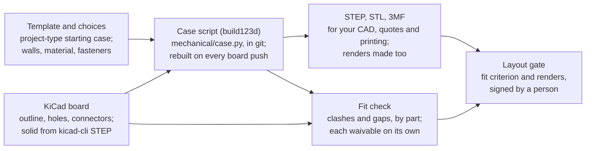

# Enclosure CAD engine for trace

Status: design, October 2026. Decided 29 October 2026; nothing built yet.

## Summary

Use **build123d** as trace's enclosure engine, and keep FreeCAD out of the agent image. build123d is a Python library
on the same OpenCascade kernel as FreeCAD, so it writes real STEP solids, but an enclosure is a short script that trace
can write, diff, review in a pull request and rebuild in a fraction of a second.

The decision asked for: approve build123d for the mechanical module, starting with the fit check that the layout gate
already names ("The board fits its enclosure, or each clash is waived") and has nothing behind it today.

A spike on 29 October 2026 built a filleted two-part case around a 50 x 50 mm board, with standoffs, pilot holes and a
USB-C opening, ran a clash and clearance check, and wrote STEP and STL, in 0.15 seconds.

## What trace needs from a CAD engine

The engine is judged against rules trace already follows, not against general CAD features.

| Need | Why, in trace's terms |
| --- | --- |
| Runs headless in the agent image | Specialists run in the Ubuntu 24.04, ARM64 agent container on AgentCore; no display, no desktop session |
| An agent can author it | trace drafts and a person finishes, as with schematics and placement; the model has to be something an agent writes well |
| Changes can be diffed and reviewed | Releases are cut from git, and gates are signed against evidence; a binary model file shows nothing in a pull request |
| The KiCad board is the source | The board outline, mounting holes, connectors and tallest parts come from the `.kicad_pcb`, so a board change re-flows into the case |
| Exact solids out | STEP for the person's own CAD and for quoting, STL, 3MF or STEP for JLCPCB's 3D printing and CNC |
| Gate evidence | The layout gate's fit criterion needs a measured answer: clashes, minimum gaps, each named |
| Joints and assemblies | The mechanical module takes in the Autodesk assembly ontology's joints and part-whole relations |
| Fast and light | Event driven, user feels in control; the installer stays light and the image does not balloon |

## Options compared

build123d meets every need; FreeCAD meets them only through its Python console, at several times the weight; OpenSCAD
fails on exact solids.

| | build123d | CadQuery | FreeCAD (headless) | OpenSCAD |
| --- | --- | --- | --- | --- |
| Latest version | 0.13.0, Sep 2026 | 2.8.0, Jun 2026 | 1.1, Mar 2026 | 2021.01 stable, nightly builds since |
| Kernel | OpenCascade (via OCP 8.0) | OpenCascade (via OCP 7.9) | OpenCascade | Mesh (CGAL or Manifold) |
| Model is | A Python script | A Python script | A binary `.FCStd` document, scriptable | A `.scad` script |
| Diff in a pull request | Yes | Yes | Only the script that drives it | Yes |
| STEP out | Native | Native | Native | No: mesh only (STL, 3MF) |
| Linux ARM64 | pip wheels | pip wheels | conda-forge (about 120 MB package, plus Qt) | apt |
| Joints, assemblies | Rigid, revolute, linear, cylindrical and ball joints built in | Assembly constraints | Assembly workbench (1.0 and later) | None |
| KiCad board in | STEP from `kicad-cli pcb export step`, already in the image | Same | Same, or the KicadStepUp workbench | STL only |
| License | Apache 2.0 | Apache 2.0 | LGPL 2.1 | GPL 2 |

**CadQuery** is build123d's parent and stable, but it pins the older OCP 7.9 and pulls in a VTK viewer stack that trace
does not need. build123d is the more actively developed of the two (0.12 and 0.13 shipped in September 2026).

**FreeCAD** has the strongest person-facing tools, including KicadStepUp for keeping KiCad and the case in step.
Headless, though, an agent drives it through the same OpenCascade calls build123d makes, inside a desktop application it
does not use, and the source of truth becomes a binary document.

**Hosted CAD** (Onshape, Fusion) was not shortlisted: trace's specialists would depend on an outside account and API
for every rebuild.

## Recommendation

Adopt build123d, pinned to 0.13, in the agent image's existing Python environment; do not install FreeCAD there.

Why:

- **It fits how trace already works.** The case is a script in the project repository, like firmware and constraint
  files. A pull request shows exactly which wall, boss or opening changed, and a gate signature points at a commit.
- **The board stays the source.** The script reads the board's outline, holes and connector positions, so moving a
  connector moves its opening on the next run.
- **The fit check is cheap.** A boolean intersection gives the clash volume and a distance query gives each gap, per
  part, by name. The spike did both in 0.15 seconds.
- **Joints match the ontology.** build123d's joint types line up with the joint concepts taken from the Autodesk
  assembly ontology, so the mechanical module's records can name real objects in the model.
- **Same kernel, same output.** The STEP it writes opens in FreeCAD, Fusion or SolidWorks, so a person who prefers a
  desktop tool loses nothing.

What we give up:

- **No graphical editor.** A person finishes a case through parameters, the script, chat or a handed-in file. A STEP
  edited in a desktop tool can be handed back, but it stops following the board until the case is rebuilt from the
  script (see Decisions).
- **A younger API.** build123d is pre-1.0 and moves quickly, so trace pins the version and upgrades deliberately.
- **Image weight.** A fresh environment with build123d is about 850 MB, about 380 MB of it the OpenCascade kernel. The
  rest is its dependencies, some of which (an interactive shell, viewer materials) trace never uses.

## How it fits trace

The case joins the journey as one more script the board drives, and the fit check becomes the evidence for the layout
gate's fit criterion.

The board feeds both the case script and the fit check, so a board change re-runs the check before the gate can be
signed.

- **Board facts in.** `kicad-cli pcb export step` (KiCad is already in the image) gives the populated board as a solid.
  A small reader pulls the outline, mounting holes, edge connectors and the tallest part on each side out of the
  `.kicad_pcb`.
- **Case script.** A new `mech` tool family writes and runs `mechanical/case.py` in the project repository. A
  per-project-type template supplies the starting case (printed two-part shell, extruded box, DIN rail), and the person
  chooses walls, material and fasteners through a skill, with trace's recommendation and its reason.
- **Fit check.** The case and board are intersected and measured. Each clash and each gap under the clearance rule is
  named by part reference, so it can be waived one by one, like design rule findings.
- **Outputs.** STEP for the person's CAD and quotes, STL, 3MF or STEP for JLCPCB's 3D printing and CNC. The render
  specialist already loads STEP, so case renders join board renders for approval.
- **Records.** The case, its parts, joints and fasteners are written as JSON-LD in the mechanical module, and the gate's
  fit check is a SHACL shape over those records.
- **Who runs it.** The implementation specialist gains the `mech` tools, since it already owns placement and fixed
  parts; a separate mechanical specialist can follow if case work grows.

The Board setup skill's "every fixed part has a mechanical reason" check gets its reason from here: a connector is fixed
because the case has an opening for it.

## Decisions, 29 October 2026

Three choices are settled: JLCPCB makes cases as well as boards, clearances have defaults a person can change, and a
case can be changed three ways.

**Case fabrication at JLCPCB.** Cases are made through JLCPCB's 3D printing and CNC service (JLC3DP), alongside the
board. It offers FDM, SLA, MJF, SLS and metal printing, and 3-, 4- and 5-axis CNC milling and turning; its stated
tolerances are ±0.2 mm printed and ±0.02 mm machined. Case and board orders can share one JLCPCB cart. As with boards,
trace prepares the case order and a person submits and pays.

- The fit check gains manufacturing rules per process: minimum wall, hole and boss sizes for each print process and
  material, and tool reach, internal corner radius and wall rules for CNC.
- These capabilities are kept current automatically, like the board capabilities. JLC3DP publishes no capability data
  or API we found, so the source and refresh method is a build task.
- The person picks the process and material through the case skill, with trace's recommendation and reason (for
  example, MJF nylon for a small run of snap-fit cases).

**Clearance rules.** Defaults are 0.5 mm from board edge to wall and 1.0 mm above the tallest part. A person can set
their own per project, and per part where one needs more room (a heatsink, a connector mating face). Each changed value
is recorded with its reason, like any choice against a recommendation.

**Changing a case.** All three routes are allowed, and each ends in the same place: the case script is updated, rebuilt
and fit-checked.

| Route | What the person does | What trace does |
| --- | --- | --- |
| Manual edit | Edits `mechanical/case.py` or its parameters and pushes | Rebuilds, runs the fit check, shows what changed |
| Chat | Asks for the change in a conversation ("move the USB opening 2 mm left") | Edits the script, shows a render and the diff before committing |
| Hand in a file | Uploads a STEP, or a changed `case.py` | A script is checked and used as is. A STEP is imported into the script as the case body, so the fit check, manufacturing rules and outputs still run |

A handed-in STEP no longer follows the board by itself. When the board changes, trace says which openings or holes may
now be wrong, and offers to rebuild from the script with the person's changes re-applied, or keep the file and record a
waiver.

## Risks and next steps

| Risk | Likelihood | Mitigation |
| --- | --- | --- |
| A build123d release breaks a case script | Medium | Pin the version; sample-project cases run in CI on every upgrade |
| Agent-written geometry fails in ways a test misses (thin walls, unprintable overhangs) | Medium | Wall, overhang and boss rules checked in the fit check; renders approved by a person at the gate |
| JLC3DP's capabilities change and are published only as web pages | Medium | Refresh on a schedule, keep the source page and date with each rule, and flag a rule older than its refresh period |
| ARM64 wheel lags a release | Low | Wheels for Linux ARM64 ship with each OCP release; stay one version behind if needed |
| Image grows past the build time budget | Low | Install in its own Docker layer; measure on the CodeBuild runner before merging |

Next steps:

1. Add build123d to the agent image and the `tracebridge` Python package as a `mech` extra.
2. Build the fit check first, against the sample `sensor-node` board, with the clearance defaults and per-project and
   per-part overrides, and wire it to the layout gate's fit criterion.
3. Add the case script and its template for the printed two-part shell, with the three ways to change it: manual edit,
   chat and a handed-in file.
4. Add JLC3DP's print and CNC rules to the fit check, kept current automatically, and case order preparation beside the
   board order.
5. Add the mechanical module's records and SHACL shape.

## Sources

- [build123d on PyPI](https://pypi.org/p/build123d): version 0.13.0, 21 Sep 2026, Apache 2.0, depends on
  cadquery-ocp-novtk 8.0
- [cadquery-ocp on PyPI](https://pypi.org/project/cadquery-ocp/): 8.0.1.1.0, 5 Oct 2026, wheels for Linux ARM64 and
  x86-64
- [FreeCAD 1.1 released](https://www.phoronix.com/news/FreeCAD-1.1-Released), Phoronix, 25 Mar 2026
- [FreeCAD on conda-forge](https://anaconda.org/conda-forge/freecad): Linux ARM64 builds, about 120 MB package
- [KicadStepUp workbench](https://wiki.freecad.org/KicadStepUp_Workbench), FreeCAD wiki
- [OpenSCAD](https://en.wikipedia.org/wiki/OpenSCAD): latest stable 2021.01, mesh export only
- [JLC3DP capabilities](https://jlc3dp.com/pt/capabilities) (processes, materials, tolerances) and
  [combining JLC3DP and JLCPCB orders](https://jlc3dp.com/hk/help/article/how-to-combine-orders-for-jlc3dp-and-jlcpcb-products)
- This repository: `agent/Dockerfile`, `src/core/journey.ts` (layout gate fit criterion), `src/tools/render/model.ts`
  (STEP loading)
- Spike: build123d 0.13.0 on Python 3.13, x86-64, 29 Oct 2026; two-part case, fit check, STEP and STL in 0.15 s
