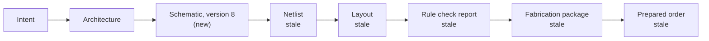

# Trace Ontology — Design

Status: design, October 2026. Decided 29 and 30 October 2026; nothing built yet. The build plan is [ontology-plan.md](ontology-plan.md).

## Summary

Trace gets its own small ontology in three modules: a **journey module** for the journey record (stages, gates, signatures, waivers, questions, hand-offs), a **board module** for the design itself (intent, parts, schematic, layout, fabrication package, prepared order), and a **mechanical module** for the enclosure (the shared mechanical interface, case parts, openings and 3D files). A separate file aligns them to the Si2 AI/ML EDA ontology by name, without importing it.

Decisions taken:

- **Align with Si2, don't import it.** Reuse its agent-workflow class names (`Flow`, `Stage`, `DecisionPoint`, `AgentAction`, `FallbackStrategy`, `HeuristicRule`, `SuccessMetric`) and its input/output pattern (`isInputTo`, `isOutputOf`). Its silicon classes stay out.
- **The ontology describes trace's existing records; it does not replace them.** trace keeps its records in SQLite (the journey record, the agents' facts, the design record, the project database). The ontology is the shared vocabulary and rule set over those tables, and JSON-LD is produced only where another program needs it: connected systems, the MCP endpoint and exports. This replaces the earlier "JSON-LD files first" choice, which predates reading the code.
- **Gate checks are SHACL shapes behind trace's existing criteria.** Each trace-owned criterion of an existing gate (for example "The board fits its enclosure, or each clash is waived") gets a shape whose result is the criterion's check. Gates, signing and waivers stay as built.

What it changes for Trace: the journey record becomes queryable, specialists can see which outputs went stale when an input changed, the knowledge explorer gets a typed graph, and the remote MCP endpoint can answer "what is this and what depends on it" without guessing.

## Fit with trace as built

Read against trace's main branch on 30 October 2026, much of what this design assumed already exists, so the ontology attaches to it rather than adding a parallel store, new gates or new functions.

| This design assumed | trace already has | So the ontology |
| --- | --- | --- |
| A JSON-LD journey record in the bucket | `projects/<owner>/<repo>/journey/journey.db` (SQLite, written only by the API), copied into the repository's `.trace/project.db` when a release is cut | Maps each table to classes and properties; no second store |
| New gates (Intent agreed, Schematic complete, Case fits …) | Eleven gates with criteria, each owned by a person or by trace, with evidence; signing, waivers and "opened the evidence" rules in `src/core/journey.ts` | Uses trace's gate and criterion names; shapes back the trace-owned criteria |
| A `Decision` with `Recommendation`s | `questions` rows with options listed recommended-first with a reason, and `design_decisions` | Maps `Decision` and `Recommendation` onto them |
| A `HandOff` record and queued `Job` | `handoffs` in the agents' facts (`journey-agent/facts.db`) and the job index (`jobs.db`) | Maps onto them |
| Agent check results | `criterion_checks` in the agents' facts | A shape's result is written there, like any checker tool |
| Board facts from KiCad | Run records and artifacts in `.trace/project.db`; the design record (intent, requirements, architecture, pin plan) in the repository | Adds board facts where the run record has none, as artifacts of a run |
| New Lambda functions | One tools function per project (KiCad, Blender, FPGA tools, CalculiX) on the tools image; CPU and GPU Batch jobs; the API runtime | New work runs as tools in the tools function and actions in the API |
| New event types | One events topic per project, fed by the bucket's object-created events for `journey.db`, `jobs.db` and `facts.db` | Staleness is computed on read, as trace computes every journey state; existing events wake waiting agents |
| A new graph explorer | `graph.neighbourhood` and the Cytoscape graph view, with its own node and link kinds | Becomes the source of those kinds and adds board and mechanical ones |
| A new MCP endpoint | The `mcp` runtime and the external API, with an allow-list of actions and scopes | Adds read actions to the allow-list |
| Templates in installation settings | Four templates (board, FPGA, firmware, mixed) defined in code | Moving them into installation settings is still to do |
| A case model and "Case fits" gate | The enclosure design note: build123d chosen, the case as `mechanical/case.py` in the project repository, the fit check as the layout gate's `fit` criterion | Follows the note; the fit check's shape backs that criterion |

One more constraint from the code: AgentCore's 2 GB image limit is why KiCad and similar programs moved to the tools image, so build123d (about 850 MB with its kernel) belongs in the tools image too, not the agent image the enclosure note names.

## Goals and non-goals

**Goals**

1. One shared vocabulary for every specialist, skill, screen and external caller, so "gate", "waiver" or "key part" means the same thing everywhere.
2. A journey record that validates against a schema and can be queried across projects.
3. Typed links from each artifact to the inputs it was made from, so staleness is computed, not remembered.
4. Hard gates expressed as machine-checkable rules that a reviewer can also read.
5. A graph the knowledge explorer can draw and the remote MCP endpoint can serve.
6. Small enough to read in an afternoon: about 80 classes across the board, journey and mechanical modules.

**Non-goals**

- Replacing KiCad's file formats. The ontology describes files and their relationships; it does not model every graphic primitive inside them.
- Modelling silicon or FPGA internals. If Trace ever needs them, the Si2 classes can be imported then.
- A full parts database. Parts are cached facts about supplier offers at a point in time, not a catalogue Trace maintains.
- Reasoning-heavy inference. Validation uses SHACL; OWL reasoning is limited to subclass lookups.
- A user-facing query language. People use screens; agents use curated MCP tools.

## Principles and conventions

The ontology lives in the trace repository under `ontology/` and ships with the code it describes.

| File | Holds | Prefix |
| --- | --- | --- |
| `trace-core.ttl` | Shared base: `DesignArtifact`, `ArtifactVersion`, the input/output properties | `tc:` |
| `trace-journey.ttl` | Journey record classes and properties | `tj:` |
| `trace-board.ttl` | Board design classes and properties | `tb:` |
| `trace-mech.ttl` | Enclosure and mechanical interface classes and properties | `tm:` |
| `trace-si2-align.ttl` | Mappings to Si2 names; the only file that mentions `eda:` | — |
| `shapes/*.ttl` | SHACL shapes, one file per gate plus record-level shapes | `tsh:` |
| `context.jsonld` | JSON-LD context mapping JSON keys to the terms above | — |

**Namespaces.** Base `https://trace-eda.com/ns/trace/` with `core#`, `journey#`, `board#` and `mech#` under it, and the JSON-LD context at `https://trace-eda.com/ns/trace/context/<version>.jsonld`. Publishing files at those addresses is optional; the names only have to stay stable.

**Naming.** Classes in UpperCamelCase, properties in lowerCamelCase, both in English nouns and verbs a non-specialist would use. Where Si2 already has a name for the same idea, Trace uses that name.

**Labels.** Every term has an `rdfs:label` in plain language and an `rdfs:comment` of one or two sentences. Acronyms appear only as `skos:altLabel` (for example "Bill of materials" with alt label "BOM"). Screens read the label, so the no-acronyms rule holds in the UI without extra work.

**Identifiers.** Instances use URNs scoped to the installation and project: `urn:trace:<install>:<project>:<kind>:<id>`. They never contain user names or part numbers that could change.

**Versioning.** Each file carries `owl:versionInfo` using semantic versioning. Adding a class or optional property is a minor change; renaming or removing a term is a major change and needs a migration script for stored records. The JSON-LD context is versioned with the ontology, and every stored record names the context version it was written with.

**Closed by default.** Records are validated as closed shapes: an unknown property is an error, not silently kept. This catches typos from agents early.

## Alignment with Si2

Trace keeps Si2's names where the meaning matches and declares the link in `trace-si2-align.ttl`; nothing else in Trace imports the Si2 file. The [Si2 ontology](https://github.com/si2org/aiml_schema_ontology) is Apache-2.0, one commit old and aimed at silicon design, so a loose alignment protects Trace from its churn.

| Trace term | Si2 term | Relation | Note |
| --- | --- | --- | --- |
| `tj:Journey` | `eda:Flow` | subclass | A journey is a flow instance from a template |
| `tj:Stage` | `eda:Stage` | equivalent | Same meaning |
| `tj:Gate` | `eda:DecisionPoint` | subclass | A decision point that needs a signature |
| `tj:AgentAction` | `eda:AgentAction` | equivalent | Same meaning |
| `tj:FallbackStrategy` | `eda:FallbackStrategy` | equivalent | Same meaning |
| `tj:HeuristicRule` | `eda:HeuristicRule` | equivalent | Rules carried by skills |
| `tj:SuccessMetric` | `eda:SuccessMetric` | equivalent | Same meaning |
| `tc:DesignArtifact` | `eda:DesignArtifact` | equivalent | Root of every file or model Trace produces |
| `tc:isInputTo` / `tc:isOutputOf` | `eda:isInputTo` / `eda:isOutputOf` | equivalent property | The input/output pattern |
| `tb:Netlist`, `tb:Net`, `tb:Pin`, `tb:Via`, `tb:Layer` | same names under `eda:` | subclass | Board meaning is narrower than chip meaning |
| `tb:DesignRule` | `eda:Constraints` | subclass | Fabricator-derived rules |
| `tb:DesignRuleCheckReport` | `eda:VerificationReport` | subclass | Output of a rule check |

The Si2 prefix is whatever `eda_ontology.ttl` declares; the alignment file pins the exact Si2 commit it was written against, and a CI check flags any aligned Si2 term that disappears in a newer commit.

## Journey module

The journey module records who did what, why, and who approved it, for one project from intent to prepared order. It has 20 classes.

**Classes**

| Class | Meaning | Key properties |
| --- | --- | --- |
| `JourneyTemplate` | The stages and gates for one project type, kept in the installation's settings | `forProjectType`, `hasStageTemplate` (ordered) |
| `Journey` | One project's run through a template | `fromTemplate`, `forProject`, `hasStage`, `currentStage` |
| `Stage` | A phase such as Architect or Capture | `stageKind`, `status`, `startedAt`, `endedAt`, `hasGate` |
| `Gate` | A hard check that ends a stage | `checkedBy` (a SHACL shape), `status`, `hasSignature`, `hasWaiver` |
| `Signature` | One admin's approval of a gate | `signedBy`, `signedAt`, `ofGateRun` |
| `GateRun` | One evaluation of a gate's shape | `result`, `violations`, `evaluatedAt`, `againstVersions` |
| `Waiver` | An accepted exception to one rule | `waivesRule`, `forSubject`, `reason`, `grantedBy`, `expiresWhen` |
| `Question` | Something Trace needs a person to answer | `askedBy`, `askedOf`, `answer`, `blocksStage` |
| `Decision` | A choice a person made | `options`, `chose`, `madeBy`, `hasRecommendation` |
| `Recommendation` | Trace's suggested option | `recommends`, `justification`, `confidence` |
| `AgentAction` | Something a specialist did | `performedBy`, `usedSkill`, `used` (inputs), `generated` (outputs), `outcome` |
| `HandOff` | A recorded request from one specialist to another | `fromSpecialist`, `toSpecialist`, `request`, `startsJob`, `resolvedBy` |
| `Job` | The queued work a hand-off starts | `status`, `queuedAt`, `finishedAt` |
| `Specialist` | An agent role in Trace | `hasSkill`, `promptVersion` |
| `Skill` | Guidance that sets a minimum quality bar | `hasHeuristicRule`, `hasSuccessMetric`, `hasFallbackStrategy` |
| `HeuristicRule` | A rule of thumb a skill applies, such as "prefer in-stock parts" | `statement`, `appliesTo` |
| `SuccessMetric` | How an action is judged to have worked | `measure`, `threshold` |
| `FallbackStrategy` | What to do when the main approach fails | `trigger`, `alternative` |
| `Person` and `ProjectRole` | A user and their per-project role | `role` = `Contributor` or `Reviewer`; `isAdmin` |

**Rules the module encodes**

- A `Decision` must carry at least one `Recommendation` with a `justification`, so "always recommend with reasons" is enforced by data, not by habit.
- A `Gate` passes only when its latest `GateRun` has no violations (or each violation has a live `Waiver`) and it has one `Signature` from an admin.
- Specialists never act on each other directly: any cross-specialist work is a `HandOff` that `startsJob`, which keeps the record complete.
- `Signature.ofGateRun` ties the signature to the exact versions checked; a later change to those versions reopens the gate.

**Where templates live.** Project-type templates belong in each installation's settings. Today trace's four templates (board, FPGA, firmware and mixed, with Certify, Produce and Sustain as options) and their gates and criteria are defined in code (`TEMPLATES` and `GATES` in `src/core/journey.ts`). The code's definitions become the defaults a new installation is seeded with, admins may change them in settings, and a changed template is checked against `tsh:JourneyTemplateShape` on save so it cannot start a broken journey. Each journey keeps the template version it started from.

**Example record (JSON-LD, abridged)**

```json
{
  "@context": "https://trace-eda.com/ns/trace/context/1.0.jsonld",
  "@id": "urn:trace:acme:led-panel:gate:capture-done",
  "@type": "Gate",
  "label": "Schematic complete",
  "checkedBy": "tsh:CaptureCompleteShape",
  "status": "passed",
  "latestRun": {
    "@type": "GateRun",
    "evaluatedAt": "2026-10-29T03:12:00Z",
    "result": "pass-with-waivers",
    "againstVersions": ["urn:trace:acme:led-panel:schematic:v7"]
  },
  "hasWaiver": [{
    "@type": "Waiver",
    "waivesRule": "tsh:PartInStock",
    "forSubject": "urn:trace:acme:led-panel:component:U3",
    "reason": "Supplier restock confirmed before order date",
    "grantedBy": "urn:trace:acme:person:marc"
  }],
  "hasSignature": [{
    "@type": "Signature",
    "signedBy": "urn:trace:acme:person:marc",
    "signedAt": "2026-10-29T03:20:00Z"
  }]
}
```

## Board module

The board module describes what is being built, from the stated intent to the order a person submits. It has 30 classes, grouped by the stage that creates them.

**Intent and architecture**

| Class | Meaning | Key properties |
| --- | --- | --- |
| `Intent` | What the board must do, in the user's words | `statement`, `hasRequirement` |
| `Requirement` | One testable need, such as a supply range or connector | `kind`, `value`, `unit`, `priority` |
| `Architecture` | Blocks and interfaces that meet the requirements | `hasBlock`, `satisfies` |
| `FunctionalBlock` | A part of the architecture, such as power or input/output | `implementedBy`, `hasInterface` |
| `Interface` | A connection between blocks or to the outside | `signalKind`, `voltage` |
| `KeyPart` | A part chosen during Architect because the design depends on it | `refersToPart`, `forBlock`, `chosenIn` (a `Decision`) |

**Parts and supply**

| Class | Meaning | Key properties |
| --- | --- | --- |
| `Part` | A manufacturer part number | `mpn`, `madeBy`, `hasSymbol`, `hasFootprint`, `datasheet` |
| `Manufacturer` | Who makes the part | `name` |
| `Supplier` | Who sells it, such as JLCPCB's parts library | `name`, `isAssemblyPartner` |
| `SupplierOffer` | Stock and price seen at a moment | `offeredBy`, `sku`, `stock`, `unitPrice`, `currency`, `observedAt` |
| `PartSubstitute` | A part accepted in place of another | `original`, `substitute`, `reason` |

**Schematic (Capture)**

| Class | Meaning | Key properties |
| --- | --- | --- |
| `Symbol` | The schematic drawing of a part | `library`, `hasPin` |
| `Schematic` | The schematic design file | `format`, `hasSheet`, `hasComponent` |
| `Component` | One placed part, such as U3 | `reference`, `usesPart`, `value`, `hasPin` |
| `Pin` | A connection point on a component | `number`, `name`, `electricalType` |
| `Net` | A set of connected pins | `name`, `connects`, `netClass` |
| `NetClass` | Shared rules for a group of nets | `traceWidth`, `clearance` |
| `Netlist` | The connection list exported from the schematic | `derivedFrom` a `Schematic` version |

**Layout**

| Class | Meaning | Key properties |
| --- | --- | --- |
| `Footprint` | The copper pattern for a part | `library`, `hasPad` |
| `Board` | The layout design | `outline`, `hasStackup`, `hasPlacement` |
| `Stackup` | The layer build | `hasLayer`, `thickness` |
| `Layer` | One copper, mask or silkscreen layer | `kind`, `order` |
| `Placement` | Where a component sits | `ofComponent`, `x`, `y`, `rotation`, `side`, `proposedBy` |
| `Via` | A hole joining layers | `drill`, `kind` |
| `DesignRule` | A limit from the fabricator, such as minimum trace width | `parameter`, `limit`, `unit`, `fromCapability` |
| `DesignRuleCheckReport` | The result of checking the board against the rules | `violations`, `ranAt` |

**Fabrication and order**

| Class | Meaning | Key properties |
| --- | --- | --- |
| `FabHouse` | A fabricator or assembler; JLCPCB first | `name`, `hasCapability` |
| `FabCapability` | What a fab house can make, as design rules; synced automatically | `hasDesignRule`, `asOf` |
| `FabricationPackage` | Everything sent to the fab house | `hasFile` (`GerberSet`, `DrillFile`, `BillOfMaterials`, `PickAndPlaceFile`), `forFabHouse` |
| `PreparedOrder` | The order Trace prepares for a person to submit | `forPackage`, `quantity`, `quote`, `status`, `submittedBy` |

The four fabrication file kinds are subclasses of `FileArtifact` in the core module, not counted above. A `PreparedOrder` never reaches `submitted` from an agent action: only a `Person` can set `submittedBy`, matching the rule that Trace prepares orders and a person submits and pays.

**Keeping fab capabilities current.** JLCPCB's capabilities are synced automatically, never typed in. A scheduled sync job reads JLCPCB's published capabilities (through an API if one is offered, otherwise its capabilities pages) and writes a new `FabCapability` version with an `asOf` time only when something changed. Each `DesignRule` is derived from that version, so a change makes every rule check, fabrication package and prepared order built against the old rules stale through the normal staleness rule, and raises an event.

JLCPCB cannot push changes, so this is one of the few polled checks; the main screen shows when it last ran and when it runs next. If a sync fails or the source format changes, the last good version stays in force, the failure shows on the operations screen, and the `Order ready` gate warns that capabilities may be out of date.

**Example (Turtle)**

```turtle
:U3 a tb:Component ;
    tb:reference "U3" ;
    tb:usesPart :part-tps62130 ;
    tc:isOutputOf :action-capture-42 .

:offer-u3-2026-10-29 a tb:SupplierOffer ;
    tb:offeredBy :jlcpcb-parts ;
    tb:forPart :part-tps62130 ;
    tb:stock 0 ;
    tb:observedAt "2026-10-29T02:00:00Z"^^xsd:dateTime .
```

## Mechanical module

The mechanical module makes the enclosure an ordinary chain of artifacts with the same staleness, gates and records as the board. Its core is one shared `MechanicalInterface` that both the board layout and the enclosure are made from, so neither is derived from the other and the staleness rule never loops. It lives in `trace-mech.ttl` with the prefix `tm:` and has 12 classes (the 11 below plus the case-edit record described under free-form changes).

**Classes**

| Class | Meaning | Key properties |
| --- | --- | --- |
| `MechanicalInterface` | The agreed contract between board and case | `hasOutline`, `hasMountingPoint`, `hasOpening`, `hasKeepOut`, `maxComponentHeight`, `tolerance` |
| `BoardOutline` | The board's shape and thickness | `shape`, `thickness`, `unit` |
| `MountingPoint` | A hole or slot that fixes the board | `x`, `y`, `diameter`, `fastener` |
| `Opening` | A cut in the case for something on the board | `forComponent`, `face`, `x`, `y`, `width`, `height` |
| `KeepOutZone` | Space the board must leave clear | `region`, `side`, `reason` |
| `Enclosure` | The case as a whole | `hasPart`, `outerSize`, `material`, `madeFrom` an interface version |
| `EnclosurePart` | One piece, such as base or lid | `partKind`, `wallThickness`, `hasStandoff` |
| `Fastener` | A screw, insert or clip | `kind`, `size`, `length` |
| `Material` | What a part is made of | `name`, `process` (print, machine, mould) |
| `MechanicalModelFile` | A 3D file | `format` (STEP, STL), `isOutputOf` |
| `ComponentEnvelope` | A component's 3D size on the board | `ofComponent`, `height`, `boundingBox` |

**Where the facts come from**

- **Intent.** Physical needs are ordinary `Requirement`s with `kind` = mechanical: overall size, mounting method, environment such as splash resistance. The architecture must satisfy them like any other requirement.
- **The board.** The extractor reads the board outline, mounting holes and placements, and takes component heights from KiCad's 3D export. These become `BoardOutline`, `MountingPoint` and `ComponentEnvelope` facts.
- **The interface.** Trace drafts the `MechanicalInterface` from the requirements and the placed edge connectors; a person adjusts and agrees it, matching how schematics and placements work.

**The chain**

Requirements → mechanical interface → enclosure model → print or machining files → prepared enclosure order. The board layout is also made from the interface version. A connector that moves inside its agreed opening makes only the board stale; a change to the interface makes both the board and the case stale, and the main screen says why, for example "The case is out of date because the USB connector opening moved 2 mm."

**Making the model.** As the enclosure design note decides, the case is a build123d script, `mechanical/case.py`, in the project repository, rebuilt on every board push, so a pull request shows exactly which wall, boss or opening changed and a gate signature points at a commit. A new `mech` tool family writes and runs it in the project's tools function (build123d is too large for the agent image), and the implementation specialist owns it. Each part, joint and fastener in the script carries the identifier of its record, so the records name real objects in the model.

**Clearances.** Defaults are 0.5 mm from board edge to wall and 1.0 mm above the tallest part. A person can set their own per project, and per part where one needs more room (a heatsink, a connector's mating face); each changed value is recorded with its reason, like any choice against a recommendation. The values in force are part of the `MechanicalInterface` version, so changing them makes the case stale.

**Changing a case.** All three routes end in the same place: the case script is updated, rebuilt and fit-checked. Each change is a `CaseEdit` record (one more class, making 12) linked to the commit it produced.

- **Manual edit.** The person edits `mechanical/case.py` or its parameters and pushes; trace rebuilds, runs the fit check and shows what changed.
- **Chat.** The person asks for the change ("move the USB opening 2 mm left"); trace edits the script and shows a render and the diff before committing.
- **Handing in a file.** A changed `case.py` is checked and used as is. A STEP is imported into the script as the case body, so the fit check, manufacturing rules and outputs still run.

An imported STEP body does not follow the board on its own. When the board or interface changes after one, trace marks the case stale, re-runs the fit check on it, and asks the person to keep it, rebuild from the script, or hand in a new file, recommending one with its reason.

**Fabrication.** Cases are made through JLCPCB's 3D printing and CNC service (JLC3DP), and case and board orders can share one cart; trace prepares, a person submits and pays. Each process (FDM, SLA, MJF, SLS, metal printing; 3-, 4- and 5-axis milling and turning) has its own `FabCapability`: minimum wall, hole and boss sizes per print process and material, and tool reach, internal corner radius and wall rules for machining. JLC3DP publishes no capability data or API that has been found, so the source and refresh method are a build task; the person picks process and material through the case skill, with trace's recommendation.

**The fit check (layout review, criterion `layout.fit`)**

This is the existing criterion "The board fits its enclosure, or each clash is waived", which has nothing behind it today. Its shape checks:

- No clash between case and board; each clash is named by part reference and can be waived on its own.
- Board edge to wall at least the clearance in force (0.5 mm by default), per part where set.
- The tallest component plus the clearance above parts (1.0 mm by default) is below the lid's inner height.
- Every edge connector has an `Opening` within the interface tolerance, and every `MountingPoint` lines up with a standoff.
- Outer size meets the size requirement, and walls, holes and bosses are within the chosen process's capability.

### Assembly reasoning

The mechanical module borrows the vocabulary of Autodesk Research's [assembly ontology for generative design](https://research.autodesk.com/publications/towards-an-ontology-for-generative-design-of-mechanical-assemblies/) (Aameri, Cheong and Beck, Applied Ontology, 2019) so Trace can rule out case designs that cannot work before it builds any 3D model. That work pairs a multi-dimensional mereotopology (parthood and connection, extending Casati and Varzi) with a qualitative shape ontology based on Hilbert's geometry, and uses the resulting constraints to prune infeasible configurations. Trace adopts its concepts, not its full first-order axioms: the paper's logic is richer than OWL and SHACL can express, and Trace only needs a fast feasibility filter.

**Added classes (9)**

| Class | Meaning | Key properties |
| --- | --- | --- |
| `SpatialRegion` | Any region a part occupies or touches | `dimension` (0–3), `ofPart` |
| `PointRegion`, `CurveRegion`, `SurfaceRegion`, `SolidRegion` | Regions by dimension: a hole centre, an edge or axis, a face, a body | as above |
| `Assembly` | A set of parts put together, which may contain sub-assemblies | `hasPart`, `hasJoint`, `hasStep` |
| `Joint` | How two parts are held together | `joins` (two parts), `jointKind`, `usesFastener`, `atRegion` |
| `AssemblyStep` | One step in putting the assembly together | `order`, `adds`, `requires` |
| `ConfigurationOption` | One candidate case design before modelling | `choices`, `feasible`, `prunedBy`, `rank` |

`jointKind` is a closed list: fixed, fastened (screw or insert), snap-fit, press-fit, bonded, hinged, sliding and ball. The board is a part of the case assembly like any other, joined to its standoffs by fastened joints.

**Relations**

| Relation | Meaning | Example |
| --- | --- | --- |
| `partOf` | Parthood; transitive | Lid `partOf` enclosure assembly |
| `connectedTo` | Regions share at least a boundary | Board connected to standoff |
| `externallyConnected` | Touch without overlapping | Connector face against opening edge |
| `overlaps` | Share interior | Two solids overlapping = interference |
| `incidentOn` | A lower-dimension region lies on a higher one | A hole axis incident on the base face |
| `between` | Ordering along a line | Board between base and lid |

Regions of the same dimension are related by parthood and connection; regions of different dimensions are related by incidence, following the paper's approach.

**Feasibility rules** (used to prune options before modelling, and run again on the real model as part of the fit check)

- No two solid regions of different parts overlap.
- Every part reaches the base through a chain of joints, so nothing floats.
- Every opening's surface region is externally connected to its connector's mating face.
- Every fastened joint's fastener is incident on a hole axis in both parts it joins.
- A valid assembly order exists: each step's required parts are present and nothing already placed blocks the part being added (for example, the board goes in before the lid closes).
- Only hinged, sliding or ball joints may leave a part free to move.

**How Trace uses it**

1. The enclosure specialist lists the choices that define a case: split line, how the board is mounted, how the lid closes, which face each connector uses.
2. It generates the combinations as `ConfigurationOption` records and applies the feasibility rules qualitatively, using only regions and relations, no geometry kernel.
3. Surviving options are ranked against the requirements and shown to the person as recommendations with reasons, such as "Snap-fit lid: no screws, but needs 2 mm walls; fits your size limit."
4. Only the chosen option is built as a parametric 3D model; the same rules then run again on the real geometry inside the Case fits gate.

Pruned options stay in the record with the rule that pruned them, so a person can see why an obvious choice was not offered.

**Engine.** Qualitative pruning runs in Python over the option records, with simple rules in SHACL-SPARQL and assembly-order search as a small graph search. Overlap and incidence on real geometry use the CAD library's solid operations. If the paper's axioms become available in machine-readable form, they can be checked offline for consistency against Trace's rules; they are not needed at run time.

**Delivery.** Phase 7 of the plan, about 9 days: write `trace-mech.ttl`, add build123d to the tools image and the `mech` tools to the implementation specialist, draft the interface from the board, add option generation with assembly-reasoning pruning, back `layout.fit` with its shape, sync JLC3DP capabilities, and add a sample project with a case to the fixtures.

## Input/output, versions and staleness

Every artifact version records which input versions it was made from, so Trace can compute what went stale when anything upstream changes and raise an event for it.



A new schematic version makes everything made from it stale; arrows run from an input to what is made from it.

Intent and architecture stay current because the schematic was made from them, not the other way round.

**Core classes and properties (`trace-core.ttl`)**

| Term | Kind | Meaning |
| --- | --- | --- |
| `DesignArtifact` | class | Anything Trace makes or keeps about a design |
| `FileArtifact` | class | A design artifact stored as a file; has `path`, `format`, `sha256` |
| `ArtifactVersion` | class | One immutable version; has `versionOf`, `versionNumber`, `createdAt`, `gitCommit` |
| `isOutputOf` | object property | Version → the `AgentAction` or person edit that produced it |
| `isInputTo` | object property | Version → the actions that read it (inverse of `used`) |
| `derivedFromVersion` | object property | Version → each input version it was made from (shortcut over the two above) |
| `supersedes` | object property | Version → the previous version of the same artifact |
| `freshness` | datatype property | `current`, `stale` or `unknown`, computed, never typed by hand |

**Rule.** A version is `current` when every version it is `derivedFromVersion` is still the newest version of its artifact and is itself current; otherwise it is `stale`. The rule is transitive, so a new intent version marks everything below it stale in one pass, with one exception below.

**Content check.** Every artifact version records a hash of its content (`sha256` on `FileArtifact`, and a hash of the relevant facts for derived records such as board facts). When a new version's hash equals the version it replaces, it is the same artifact in substance: anything made from the older version still counts as made from the newest, and the walk stops there.

- A cosmetic schematic edit (a moved label, a reworded note) regenerates an identical netlist, so the layout and everything after it stay current.
- A real change (a swapped part, a new connection) changes the netlist's hash, so the cascade carries on as before.
- Where an artifact's file holds things that do not matter to what is made from it (a timestamp in a KiCad export, the order of rows in a report), the hash is taken over a normalised form, defined per artifact kind and tested.
- The mechanical interface works the same way: a connector moved within its agreed opening leaves the interface's hash unchanged, so the case stays current.

When the walk stops on a matching hash, the reason is kept ("the schematic changed, but the netlist it produces did not"), so a person who asks why the layout is still current gets an answer.

**How it runs.** Freshness is computed when it is read, as trace already computes stage states, the next step and whether a gate may be signed, and as the pin plan agreement already shows itself stale when the plan changes. Nothing stores a freshness flag that could drift. A push already re-runs the tools that make artifacts; when one lands, the project's existing events topic wakes any agent waiting on it, and the main screen recomputes. A criterion whose evidence is now stale shows as not met until its checker runs again, which also covers a gate signed against older evidence.

**What a person sees.** The main screen shows "Layout is out of date because the schematic changed" with a link to the change, not a list of version numbers.

## Gates as SHACL shapes

Each trace-owned criterion of trace's existing gates is backed by one SHACL shape, run as a checker tool whose result is written to `criterion_checks` like any other check. Gates, signing, waivers and the rule that a signer opens every piece of evidence stay exactly as built in `src/core/journey.ts`; violation messages feed the "what's still needed" list.

**First criteria backed by shapes**

| Gate | Criterion | Shape checks |
| --- | --- | --- |
| Architecture review | `architect.mapped`: every requirement maps to a block | Every accepted requirement is served by at least one block |
| Architecture review | `architect.stock`: every key part in stock, or its exception signed | Every key part has a current offer with stock at the build quantity, or a waiver |
| Schematic review | `capture.stock`: every part in stock, or its exception signed | The same rule over every part on the schematic |
| Layout review | `layout.fit`: the board fits its enclosure, or each clash is waived | No clash between case and board; both clearances met; every mounting point has a standoff; each failure named by part |
| Release approval | `signoff.bom`: parts list checked for cost and stock | Every line has a price and stock at the build quantity, observed within a day |
| Order approval | `fabricate.order.stock`: stock and prices checked again today | Every line's offer was observed today and is available |

Criteria owned by a person ("The blocks and key parts are approved", "The board renders are approved") stay a person's call: no shape moves them.

**Example shape**

```turtle
tsh:PartInStock a sh:NodeShape ;
    sh:targetClass tb:Component ;
    sh:sparql [
        sh:message "{$this} has no supplier with stock. Choose another part or request a waiver." ;
        sh:select """
            SELECT $this WHERE {
              $this tb:usesPart ?part .
              FILTER NOT EXISTS {
                ?offer tb:forPart ?part ; tb:stock ?s .
                FILTER (?s > 0)
              }
            }""" ;
    ] .
```

**Waivers.** trace's waivers already target a criterion, requirement, finding or test, with reason, risk, severity and where the issue is caught instead. A shape's violation is a finding: it can be waived on its own, and the criterion is met when every finding is resolved or waived, as with rule check findings today.

**Messages.** `sh:message` is written in plain language and says what to do next. Messages are reviewed with the same no-acronyms rule as the UI.

**Engine.** pySHACL with the SHACL-SPARQL extension, run in the project's tools function (Python is already in the tools image) as a `shape.check` tool that a checker calls with the criterion's shape. The project's graph is built from its databases through the mapping for each run.

## Storage, runtime and access

Records stay in trace's SQLite databases; the ontology is applied to them through a table mapping, and JSON-LD is produced only at the edges where another program reads it.

**Where records live**

| Database | Where | Written by | Ontology module |
| --- | --- | --- | --- |
| Journey record `journey.db` | `projects/<owner>/<repo>/journey/` in the central bucket | The API only (people's actions) | Journey |
| Agents' facts `facts.db` | `projects/<owner>/<repo>/journey-agent/` | Agents (questions, criterion checks, hand-offs, stuck) | Journey |
| Job index `jobs.db` | `projects/<owner>/<repo>/journey-agent/` | Runtimes | Journey (jobs) |
| Design record | The project repository | Agents, merged with people's `design_decisions` | Board (intent, requirements, architecture, pin plan) |
| Project database `.trace/project.db` | The project repository | Tools (runs, measurements, artifacts); the journey copy at release | Core (artifact versions), board, mechanical |
| Central database | `central/` | Every project, conditional writes | Board (parts, offers, datasheets); fab capabilities |

**The mapping.** One file, `ontology/mapping.ts`, says which table and column becomes which class and property (for example, a `gate_criteria` row is a `Criterion` of the `Gate` named in its `gate` column). It is checked in CI against the live schema (`ensureProjectSchema` and the design record's tables), so a new column without a mapping, or a mapping to a column that is gone, fails the build. The journey copy into `.trace/project.db` at release is unchanged.

**Writing.** Nothing new writes records. The API, agents and tools keep writing their tables as they do today; the ontology's record-level shapes run in the tests that cover those writers, so a writer that breaks a rule fails CI rather than production.

**Extracting board facts.** A `board.facts` tool, run in the project's tools function beside KiCad, reads the schematic and board after each push and stores components, nets, placements, outline and component heights as an artifact of a run in `.trace/project.db`. Where an existing tool already records a fact (rule check reports, the pin plan), the mapping reads that instead of extracting it twice.

**Querying.** The API builds a project's graph from its databases through the mapping, in memory, and answers from it; `graph.neighbourhood` already does a version of this for the graph view. A graph database is not needed while one project's records stay in the tens of thousands of facts.

**External API and MCP** (added to the allow-list in `src/api/service-policy.ts`; the `mcp` runtime exposes each as `trace_<action>`)

| Action | Scope | Returns |
| --- | --- | --- |
| `ontology.describe` | read | Label, explanation, parent classes and properties for a term |
| `record.get` | read | One record by identifier, as JSON-LD |
| `artifact.lineage` | read | What an artifact version was made from and what was made from it |
| `artifact.stale` | read | Stale artifacts in a project and the change that caused each |
| `journey.status` | read | Already exists: current stage, open questions, open gates and next action |

There is no raw query action for connected systems: the allow-list fails closed, and a query language is a person's or an admin's tool. Gate checks stay a person's action, as the external access design already decides.

Every action checks the caller's project access before answering, as the external runtime already does.

**Graph view.** The existing view's node and link kinds (`NODE_KINDS`, `LINK_KINDS` in `web/src/lib/graph.ts`) are generated from the ontology, adding component, net, artifact, gate, criterion, waiver, case and part-of kinds to today's intent, requirement, block, part, datasheet, run and decision. Its focus, distance and failing-chain rules stay as built.

## What people see

The ontology is never shown by name. Its job is to let every screen answer "what's next, why, and what changed" from one source, so the experience stays consistent without each feature re-deriving it.

**Screen requirements**

| Screen | Requirement | Comes from | Plan task |
| --- | --- | --- | --- |
| Main screen | A "what's still needed" list: one plain-language line per unmet criterion, finding, question or stale artifact, each linking to the exact component, net, opening or decision; lines clear when resolved, without a refresh | Criterion checks, questions, lineage, the project's events topic | P4.4, P5.7 |
| Main screen | A strip showing the artifact chain for the project, stale steps highlighted, each step opening its latest version | Lineage, computed on read | P4.4 |
| Any artifact | A summary line ("Layout is out of date") that expands to the cause, when it happened, who or what made the change, and the decision behind it | Run inputs, design decisions, the decisions log | P4.4 |
| Decision screen | Options recommended first with reasons; options Trace ruled out stay visible with the rule that ruled them out | The existing questions record, pruned options | P7.6 |
| Gate screen | Each finding under its criterion with its message and two actions: fix it, or waive it with a reason; signing stays disabled while any criterion is unmet, as built | Shape findings, waivers | P5.3, P5.7 |
| Reviewer view | Every waiver and case change on the project in one table | Waivers, case edits, signatures | Built for waivers; case edits in P7.8 |
| Order screen | A confirmation, not a checklist: stock and capabilities already checked, with when stock and capabilities were last checked and when the next check runs | Parts database, capability sync | P3.6, P5.2 |
| Case view | The 3D case with any clash, gap or opening problem outlined by part; edits through chat, the script or a handed-in file, with a render and diff before a chat change is committed | Fit check, case script, case edits | P7.7, P7.8 |
| Graph view | Opens centred on the item the person came from, now including components, nets, artifacts, criteria, waivers and the case | `graph.neighbourhood` | P6.4, P6.5 |
| Operations screen | Capability sync health, last and next run, and board facts failures | Capability sync, tools function | P3.6 |

**Rules for every screen**

- **Words come from labels.** Chat, screens, notifications and tool output use the ontology's labels, so a gate has one name everywhere; the no-acronyms check runs once, in CI.
- **Summary first, detail on demand.** Every status has a one-line summary; the detail is the record behind it, never a second hand-written explanation.
- **Never a dead end.** Anything that blocks the person offers the next action: fix, waive, ask, or choose a recommended option.
- **Polls are announced.** Where something is checked on a schedule, the screen shows when it last ran and when it runs next.
- **Raw graphs are for admins.** People see filtered, task-centred views; the full node-and-edge graph is opt-in.

**Message quality.** Gate and staleness messages decide whether this feels helpful or bureaucratic. Each message names the thing, the problem and the next step in under 25 words, and each is tested with someone who isn't an electronics engineer before its gate ships.

## Replay

Any project can be played back from intent to its latest gate as an animation of its graph, because every decision, check, signature and change is recorded with who and when. Three small append-only history tables close the one gap: values trace updates in place today.

**What is already history and what is not**

| Already kept as history | Overwritten in place today |
| --- | --- |
| The decisions log: every start, signature, return, answer and waiver added | A criterion's status and evidence in `gate_criteria` (a person's move, or the merged result of a check) |
| `design_decisions`, with superseded rows | A stage's `started`, `finished` and `reopened_*` columns, which a reopening clears |
| `questions` and the agents' questions, with asked and answered times | The journey's current stage, name, description, icon, build plan and template version |
| `gate_signatures`, with the criteria and evidence as signed |  |
| The agents' `criterion_checks`, one row per check |  |
| Hand-offs, jobs, runs, artifacts and git commits |  |

**The three history tables** (in `journey.db`, registered with the journey tables so they are copied into the repository when a release is cut)

| Table | One row per | Columns |
| --- | --- | --- |
| `criterion_history` | Change to a criterion's status or evidence | criterion, gate, revision, status, evidence, source (person or checker), by, by_hash, at |
| `stage_history` | Stage started, finished or reopened | stage, revision, event, reason, by, at |
| `journey_history` | Change to a journey field | field, old value, new value, by, at |

- **Written with the change.** Each row is written in the same statement path and the same conditional put as the update it records (the updates in `src/core/journey.ts` that set criterion status, finish and reopen stages, and move the current stage), so history can never disagree with the record.
- **Append-only.** Rows are never updated or deleted; their merge rule is a union by id, unlike the newer-row-wins rule of the tables they shadow.
- **Small.** A row per change, not per read; a busy project adds a few hundred rows per revision.
- **Started early.** History only exists from when it is first written, so the tables ship in phase 2, well before the player. For projects that predate them, the start of history is rebuilt from the decisions log and marked as reconstructed.

**How a replay is built**

1. **One event stream.** `journey.events` merges the decisions log, the three history tables, design decisions, questions, waivers, signatures, criterion checks, hand-offs, jobs, runs and commits in time order, each event typed by the ontology and linked to the nodes it touches.
2. **The graph as it was.** The graph builder and lineage take an "as of" time and use only records that existed then, so freshness is shown as it stood at each moment.
3. **The player.** The existing graph view with a timeline: play, pause, speed, a scrubber, stage chips that show each stage started, signed or reopened, and a caption naming who did what, from which record. Clicking any frame opens the real record behind it. Chapters follow the stages, and filters show one person's or one specialist's part.
4. **Video export.** A job renders the replay to MP4 for reviews and audits, using ffmpeg, which is already in the tools image.

**Uses.** Design reviews ("how did we get here"), onboarding, certification and audits (every signature with its evidence, in order), and looking back after a bad revision.

## Testing and CI

Every change to the ontology, shapes or context runs a pytest suite on CodeBuild before it can merge.

- **Syntax and load.** All `.ttl` files parse with RDFLib; the JSON-LD context expands without errors.
- **Labels.** Every class and property has a label and comment; no label contains an all-capitals word of two or more letters unless it is on an allow list.
- **Fixtures.** Trace's sample projects, each captured as a full set of records from intent to prepared order, plus a set of deliberately broken copies (missing footprint, out-of-stock part, stale layout, unsigned gate).
- **Shapes.** Each gate shape passes on the good fixture and fails on each broken copy with the expected message and focus node.
- **Waivers.** A broken copy with a matching waiver passes; with a waiver for a different component it still fails.
- **Staleness.** Adding a new schematic version marks the netlist, layout, rule check, fabrication package and order stale, and nothing else.
- **Alignment.** Every Si2 term named in `trace-si2-align.ttl` exists in the pinned Si2 commit.
- **Compatibility.** Stored fixture records from the previous minor version still validate; a major version bump must ship a migration that makes them validate.

The capability sync is tested against saved copies of JLCPCB's source, including a deliberately altered one, so a format change fails the build instead of production.

## Delivery phases

Eight phases, each ending with something usable; the [implementation plan](ontology-plan.md) holds the tasks, estimates and exit checks.

1. **Vocabulary from the code.** Take every name from trace's tables, gates, criteria, specialists and graph kinds.
2. **Core and journey modules, and the mapping.** Map the journey record, agents' facts and job index; check the mapping against the live schema in CI.
3. **Board module, board facts and capabilities.** Map the design record and run record, add the `board.facts` tool, and sync JLCPCB board capabilities.
4. **Lineage and staleness.** Record what each artifact was made from and compute freshness on read.
5. **Shapes behind criteria.** Back the first trace-owned criteria with shapes and move templates into installation settings.
6. **External actions and graph kinds.** Add read actions to the external allow-list and generate the graph view's kinds.
7. **Mechanical module.** The `mech` tools, case script, option pruning, the `layout.fit` shape and JLC3DP capabilities.
8. **Replay.** The event stream, the graph and freshness as of any time, the player and video export, built on the history tables added in phase 2.

## Risks and open questions

**Risks**

| Risk | Effect | Mitigation |
| --- | --- | --- |
| The ontology grows past what people read | Terms drift and agents misuse them | Cap at about 60 classes; any new class needs a fixture that uses it |
| Agents write invalid records | Gates block for the wrong reason | All writes go through `trace-record`, which validates before saving |
| KiCad format changes break extractors | Board facts go missing or stale | Version extractors; a failed extraction marks facts `unknown`, never `current` |
| Supplier stock changes between check and order | A gate passed on stock that is gone | `Order ready` re-checks stock at preparation time |
| SPARQL-based shapes are slow on big boards | Gate checks feel sluggish | Measure on the fixture; move hot rules to core SHACL or precomputed flags |
| Si2 renames or removes terms | Alignment breaks | Pin the Si2 commit; CI flags missing terms |

**Decided since the first draft**

- Fixtures come from Trace's sample projects, since there are no past boards.
- The namespace is `https://trace-eda.com/ns/trace/`.
- Project-type templates live in each installation's settings.
- JLCPCB fab capabilities are synced automatically and kept current.
