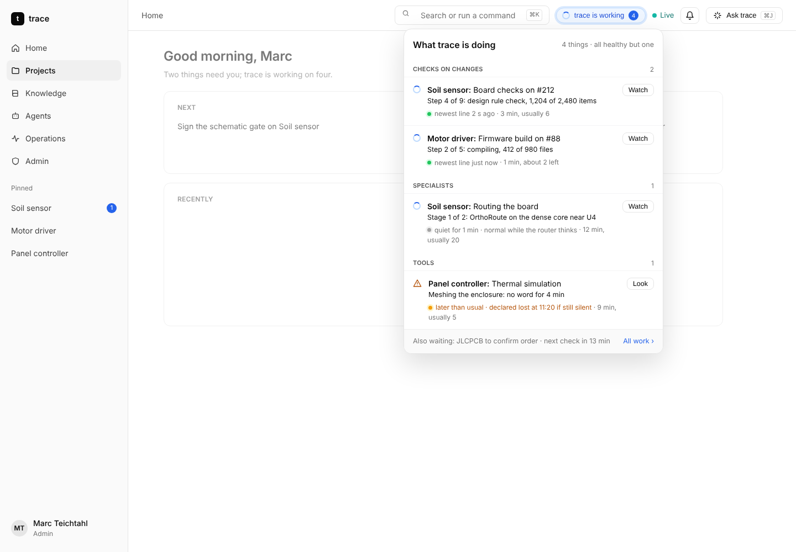
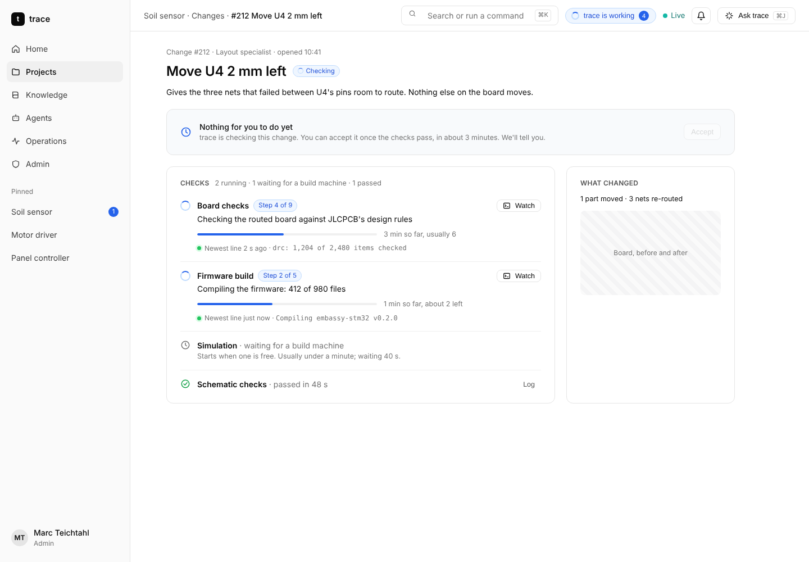
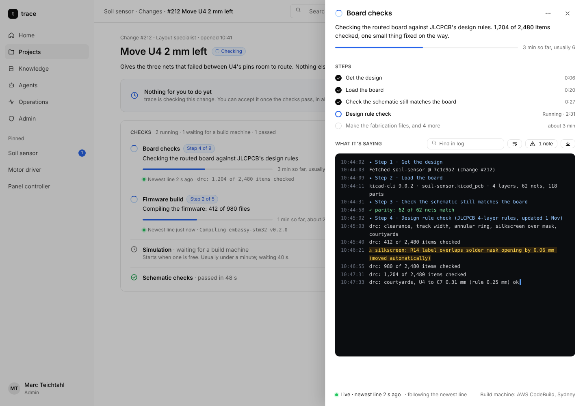
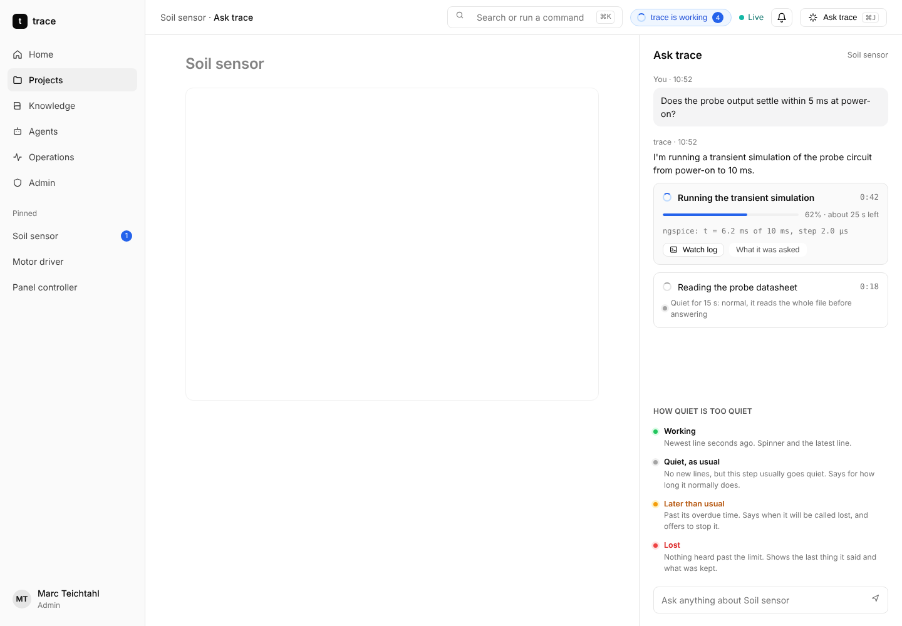
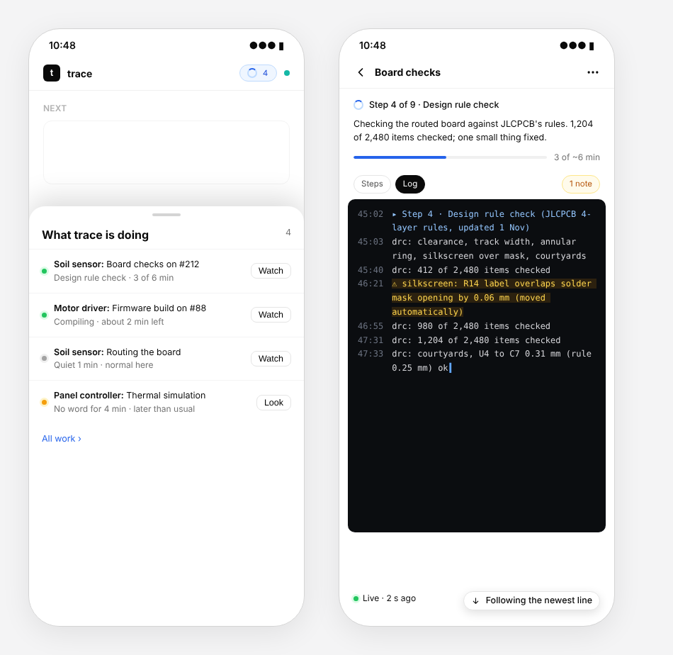

# See what trace is doing: live progress and logs

Proposal approved 3 November 2026: Marc went with every recommendation (A to F below). The build contract is at
the end; where it and the proposal disagree, the contract wins.

## The problem

When trace is busy, the app often looks as if nothing is happening:

- **Checks on a change** say only "Checks running: 1 of 3 passed". No step, no time, no log
  (`components/pull-status.tsx`, the Checks section of `routes/_app/p/$id/changes/$number.tsx`).
- **A specialist's job** has a good line (`run-line.tsx`) and a run page, but trace keeps only its last 12 lines
  (`tail` in `src/core/job-index.ts`), and the app never shows them. Live events say *that* a job changed, never what
  it said.
- **A tool in chat** shows a spinner until it finishes (`components/chat/cards.tsx` `ToolRow`): nothing while it runs,
  not even how long it has been going.
- **Nothing app-wide** says trace is working. The top bar's dot is about the connection, not the work.
- **No build logs at all** for a change's checks. The only build log in the app is the default branch's failure
  (`health.log`), and nothing reads the CodeBuild runners' own logs.

## What a person sees

### 1. "trace is working" in the top bar, with everything in one place



A pill beside Live, shown only while something runs: a spinner and how many. It opens **What trace is doing**: checks
on changes, specialists, tools and timed waits, across every project the person can see, each with its step, its time
against the usual, how recently it spoke, and **Watch**. On a phone, the pill opens the same list as a bottom sheet.

### 2. A change's checks say which step they are on



Each running check: step *n* of *m* in plain words, a progress bar when the size is known (else time so far and the
usual), how recently it spoke, and its newest line. A check still waiting for a build machine says so, and how long that
usually takes. Finished checks keep their log one tap away.

### 3. Watch: one log viewer for everything



The same sheet for a build, a specialist's job and a tool: a one-line summary of what it is doing now, the steps with
their times, then the log itself, following the newest line. Find in log, wrap lines, jump to the first problem
(warnings and errors are marked), download. The footer says it is live and when the newest line arrived. Admins also get
**Open in CloudWatch** under the "…" menu.

### 4. Tools in chat show what they are doing while they run



The tool card ticks its time, shows progress when the tool reports it, and its newest line, with **Watch log**.

### 5. Quiet is not stopped

Every running thing is in one of four states, shown the same way everywhere (the dot):

| State | When | What it says |
| --- | --- | --- |
| Working (green) | A line in the last few seconds | the newest line |
| Quiet, as usual (grey) | No lines, but this step usually goes quiet | "quiet for 1 min: normal while the router thinks" |
| Later than usual (amber) | Past the step's overdue time (the existing `heard.overdueAt`) | when it will be called lost; offers to stop it |
| Lost (red) | Past `heard.lostAt` | the last thing it said and what was kept |

### 6. On a phone



## Recommendations, and the choices

Each choice below has a recommendation and why.

**A. Where a check's log comes from.** *Recommended:* the steps from GitHub's job API (named, live), and the lines
from the project's CodeBuild runner log group (`/aws/codebuild/<prefix>-ci-<hash>`, `src/infra/runner.ts`), which is
written as the job runs. While a repository is still on GitHub's own runners, its log appears when the job finishes
(GitHub only serves logs then). *Alternative:* GitHub's log only, which means no lines until a check ends.

**B. Keeping a job's and a tool's whole log.** *Recommended:* each job and tool run writes its lines to CloudWatch
Logs, one stream per run, kept 30 days like the other logs, read through the API (`run.log`). The 12-line `tail` stays
for the lost-job summary. *Alternative:* chunks in the central bucket next to the journey, kept forever; more requests
and storage, and a release would carry them.

**C. Live, without polling.** *Recommended:* a CloudWatch Logs subscription on the runner and job log groups calls a
small function that publishes `log.appended {repo, runId, lines}` (a count, never the text, as every live event today)
at most once a second per run. The open viewer then reads the new lines. If the live connection is down, an open
viewer looks every 3 s and says when it will next look, as every polled screen does now. *Alternative:* the viewer polls
every few seconds while open.

**D. Who sees logs.** *Recommended:* everyone on the project sees the steps and the log, with tokens, keys and
anything that looks like a secret masked before it leaves the API; costs and CloudWatch links stay admin-only, as
decided for run steps. *Alternative:* the raw log for admins only, everyone else sees steps and the newest line.

**E. When quiet becomes "later than usual".** *Recommended:* learned per step from that project's past runs (how long
the step usually goes without a line, plus a margin), 2 minutes until there is history. *Alternative:* one fixed time
for everything.

**F. The app-wide indicator.** *Recommended:* the top-bar pill and panel above, everywhere in the app, hidden when
nothing runs. *Alternative:* only on Home and Operations.

## How it is built (summary)

1. **Shared:** a `LogView` component (virtualised, follow newest, find, wrap, marks, download), a `RunSheet` (summary,
   steps, `LogView`) and a `Heartbeat` dot with the four states; the API's `run.log {repo, runId, after}` returning
   lines with a cursor, masked.
2. **Checks:** `change.get`'s checks gain `jobId`, `step`, `stepIndex/stepCount`, `startedAt`, `typicalS` and
   `heardAt` from GitHub's jobs API; `run.log` reads CodeBuild's log for that job, else GitHub's once finished.
3. **Jobs and tools:** the runtime writes each run's log stream; tools get a `progress(line, fraction?)` callback; the
   chat stream carries it as an AG-UI custom event `tool.progress`, so the card updates while the tool runs.
4. **Live:** the log subscription function and `log.appended`; `invalidationsFor` learns it; the viewer subscribes only
   while open.
5. **App-wide:** an `activity.list` action (running checks, jobs, tools, waits across the person's projects) behind
   the pill, refreshed by `job.updated`, `record.changed` and `log.appended`.

Screen sources: `docs/ui/source/progress/` (`node screens.mjs` writes the pages).

## Build contract

### Names (src/core/run-logs.ts)

| What | Name |
| --- | --- |
| Log group | `/trace/<prefix>/runs` (`runsLogGroup`), kept a month; its name reaches every writer and the API as `TRACE_RUNS_LOG_GROUP` |
| A specialist's job | stream `job/<owner>/<repo>/<jobId>`, run ref `job:<jobId>` |
| A tool call | stream `tool/<owner>/<repo>/<runId>` (`newToolRunId`: `t` + base36 ms + 8 hex), run ref `tool:<runId>` |
| A check | stream `gha/<owner>/<repo>/<GITHUB_RUN_ID>/<GITHUB_RUN_ATTEMPT>/<GITHUB_JOB>`, run ref `check:<GitHub job id>` |

Lines are plain text; `▸ name` opens a step, `✓`, `⚠`, `✗` mark passed, warning, failed (`markOf`). Every line the
API returns went through `maskSecrets`. Writers never write secrets on purpose; masking is the safety net.

Why checks write their own stream: a CodeBuild-hosted runner's build log holds the runner's own messages, not the
job's steps, and GitHub serves a job's log only once it has finished. So trace's own steps (`tracectl check`, the
harness actions) copy their output into the check's stream while they run, when they run on CodeBuild (the runner
project sets `TRACE_RUNS_LOG_GROUP`); on GitHub's runners they write nothing, and the log is GitHub's once the job ends.
The steps themselves (names, which one runs, how long each took) always come from GitHub's jobs API, live.

### Who writes what

- **Worker runtime** (`src/agents/runtime/log-stream.ts`): every `log` event of a job to its stream, batched (1 s or
  100 lines), the stream made on first write. A tool call (`ToolJob.runId`, given by the API) gets `▸ <tool name>`
  first, then whatever the tool reports through `src/core/progress.ts` (`reportLine`, `reportProgress`; the process
  helpers forward their output), then `✓ done in 12 s` or `✗ <why>`. When a job or tool run ends, its gaps are learned
  (`learnQuiet`).
- **tracectl and the harness actions on CodeBuild** (`src/core/check-stream.ts`): their output lines to the check's
  stream as well as stdout.
- **Roles:** the worker runtime may `logs:CreateLogStream`/`PutLogEvents` on `job/<its repo>/*` and `tool/<its repo>/*`;
  the runner on `gha/<its repo>/*`; the API may read the group (`GetLogEvents`, `DescribeLogStreams`,
  `FilterLogEvents`).

### Live (decision C)

A subscription filter on the runs group sends every batch to the journey-events function, which publishes, at most
once a second per stream, to everyone on the project:

```ts
{ type: 'log.appended', repo, kind: 'job' | 'tool' | 'check', id, lines: number, at }
// id: the jobId, the tool runId, or '<runId>/<attempt>/<job key>' for a check
```

No text, as for every live event. The app's `invalidationsFor` maps it to `['activity.list']`, `['change.runs', repo]`
(checks) and bumps the open log view for that repo, which reads on from its cursor.

### API (src/api/actions-progress.ts)

```ts
'run.log' { repo, run: RunRef, after?: string, limit?: 1..1000 = 500 } →
  { repo, run, source: 'cloudwatch' | 'github' | 'tail' | 'none', lines: LogLine[], next: string | null,
    done: boolean, heardAt: string | null, step: string | null, usualQuietS: number,
    cloudwatch?: string /* admins only: the console link */ }
// `next` is the cursor for the following call; done: the run has ended and every line was given.
// A check reads its stream while it runs and GitHub's log once it has ended; a job with no stream falls back to the
// job index's last lines ('tail').

'change.runs' { repo, number } → { repo, number, sha, jobs: CheckJob[], updatedAt }
interface CheckJob {
  id: number; run: RunRef; name: string; workflow: string
  state: 'queued' | 'running' | 'passed' | 'failed' | 'skipped' | 'cancelled'
  startedAt: string | null; completedAt: string | null
  steps: { name: string; state: 'queued' | 'running' | 'passed' | 'failed' | 'skipped'; startedAt: string | null; completedAt: string | null }[]
  step: string | null; stepIndex: number | null; stepCount: number
  typicalS: number | null            // the job's usual length on this project (recent successful runs), null: no history
  queuedS: number | null             // queued: how long it has waited for a machine
  heardAt: string | null; newest: string | null   // its stream's newest line (running on CodeBuild only)
  usualQuietS: number; runner: 'aws' | 'github' | null
}

'activity.list' {} → { items: ActivityItem[], waits: number, updatedAt }
interface ActivityItem {
  kind: 'check' | 'job' | 'tool'; repo: string; run: RunRef; title: string
  state: 'running' | 'queued' | 'paused'
  step: string | null; stepIndex: number | null; stepCount: number | null
  startedAt: string | null; typicalS: number | null
  heardAt: string | null; newest: string | null; usualQuietS: number
  overdueAt?: string; lostAt?: string      // jobs: their heartbeat limits
  change?: number                          // checks: the change it checks
}

'tool' gains run_id?: string (TOOL_RUN_ID); the chat stream makes one for each tool call it runs.
```

### Chat

Before a backend `tool` call runs, the stream sends an AG-UI `CUSTOM` event `{ name: 'trace.tool_run', value:
{ toolCallId, repo, run: 'tool:<runId>' } }`; the tool card then ticks its time and shows the run's newest line and
Watch log.

### The app

- `components/heartbeat.tsx`: `quietState({ heardAt, usualQuietS, overdueAt?, lostAt? }, now)` →
  `working | quiet | late | lost`, and the dot with its words.
- `components/log-view.tsx`: reads `run.log` from its cursor, follows the newest line, find, wrap, jump to the first
  problem, download (a file the browser saves), live footer; reads on when `log.appended` names its repo, or every
  3 s with the next look shown when the live connection is down.
- `components/run-sheet.tsx`: the Watch sheet (a side sheet on a wide screen, a full-height drawer on a phone):
  summary, steps, log; admins' "…" holds Open in CloudWatch.
- `components/activity.tsx`: the top-bar pill and its panel (a drawer on a phone), from `activity.list`.
- The change page's Checks section reads `change.runs` beside `change.get`; RunLine gains Watch; the chat tool card
  follows `trace.tool_run`.
