# Scribe: each project's documents, always current

Proposal approved 4 November 2026: Marc went with the design below. The build contract is at the end; where it and
the proposal disagree, the contract wins.

## What it is

Scribe is a specialist that keeps four documents for every **project** (not for trace itself) in step with the work:

| Document | File in the project repository | When it exists |
|---|---|---|
| High level design | `docs/design/high-level-design.md` | from Architect |
| Low level design | `docs/design/low-level-design.md` | from Capture |
| Protocol specification | `docs/design/protocol-specification.md` | only once the design has an interface to describe (I2C, SPI, UART, CAN, 1-Wire, I2S, or a message format of its own); otherwise the reason is recorded |
| User guide | `docs/design/user-guide.md` | from Layout, complete before Fabricate |

Markdown in the repository is the source of truth. Each document is rendered to a branded PDF with the project's logo.

## What goes in them

Everything is generated from trace's own records, and every figure and value says where it came from.

- **Diagrams, flowcharts and data flows** written as Mermaid inside the markdown (easy to review in a change), and
  block diagrams and data flows drawn from the same ontology records that drive the app's React Flow views, so the
  documents and the app always match.
- **Mechanical drawings**: dimensioned top, side and section views of the case and board, and an exploded assembly,
  from the build123d enclosure model (`mech.*`).
- **Photorealistic renders** with Blender (`render.*`, `python/blender`): top, bottom, three-quarter, in-case and
  exploded, with materials matching the fabrication choices (solder mask colour, surface finish, silkscreen). Draft
  renders use Eevee while a board is changing; release renders use Cycles with denoising on a GPU runner, falling back
  to the CPU. Renders are cached by board and case version. The app's interactive 3D view is unchanged.
- **Protocol traces**: timing diagrams and decoded bus captures from simulation and test runs (`protocol.diagram`,
  `protocol.capture`), next to the message layouts they prove.
- **Key engineering values**: power (budget per rail, worst-case current, regulator headroom), thermal (hottest parts,
  temperature rise, margin to rating) and load (connector and track current, bus loading), each with its margin and
  its basis: **estimated**, **simulated** or **measured**, and the run it came from.

| Document | Figures and values |
|---|---|
| High level design | system context, block diagram, data flow, journey flowchart, hero render, power summary, key margins |
| Low level design | module diagrams, pin plan, power tree, firmware flowcharts, data flow per interface, mechanical drawings, every render, full power, thermal and load tables |
| Protocol specification | sequence diagrams, state machines, message layouts, timing diagrams, decoded traces |
| User guide | renders, exploded view, setup and troubleshooting flowcharts |

Two rules keep it trustworthy:

- **No source, no number.** A value not yet worked out shows as *pending*, never a guess.
- **Images and values go stale like text.** When a source changes, the image is re-rendered or the value recalculated,
  through the same review and gate checks.

## How it stays current

1. **Sections declare their sources.** Each document is a fixed set of sections (`src/docs/catalog.ts`); each section
   names the records it is written from (requirements, decisions, architecture, schematic, board, enclosure, protocol
   specs and runs, power and thermal results, tests). Scribe writes only between its section markers, so a person's
   own notes outside them are kept.
2. **Event driven.** Scribe starts on its own after anything that can change the documents
   (`src/api/docs-follow.ts`):
   - **a push to the default branch** (every merged change, a person's edit in the app, a released record), when the
     commit changed a record a document is written from: the hooks function asks `hook.docs`, which reads the commit's
     files and compares its project database with its parent's table by table. A commit of only the documents, or of
     only the runs Scribe makes for them, starts nothing, so Scribe's own change never starts Scribe again;
   - **a gate signed** whose new stage needs documents (from Architect on).
   One Scribe job runs per project at a time. It compares with the commit the documents were last written at (their
   front matter), not with the push that started it, so a missed or skipped event is caught by the next one.
3. **Surgical updates.** Scribe works out which sections the change touched and rewrites only those, then opens a
   stacked pull request on the change it documents, reviewed in the app like any other.
4. **Quality bar.** Each document has its own writing rules, checked by `src/docs/checks.ts`: every section present,
   sections due by the current stage written, no unexplained acronyms, every figure captioned with its kind and source,
   only the diagram kinds that document allows, every value with a basis and a source. A failed check, or a diagram
   that does not render, blocks the change.
5. **Gates.** The release approval gate has a documents criterion (`signoff.docs`, owned by trace): every document
   the release needs is there, every section due is written, and they pass the documents check. Scribe records it
   with `journey.check`, its evidence the `docs.check` run, which is recorded for that. The release report's review
   waits on it, with coverage, interference and the parts list.
6. **Rendering.** `docs.publish` (`src/tools/docs/tools.ts`) runs `python -m tracebridge.docs` as the `docs` job kind
   on the project's tools function, where KiCad and Blender already run (`agent/Dockerfile.tools`): Mermaid draws each
   diagram as SVG with its labels as text, pandoc writes Typst through `python/tracebridge/docs/template.typ`, and Typst
   makes the PDF: a cover (logo, project, document, revision, commit), a revision table, contents, numbered figures with
   their captions, and a header and footer on every page. Each PDF goes to the central bucket (below), and the publish
   run keeps where it is.
7. **Publishing.** Printed copies never grow the repository's run record (`src/docs/printed.ts`):
   - **Where.** Each PDF goes to the central bucket under the project, named by its content
     (`projects/<slug>/journey-agent/documents/printed/<sha256>.pdf`); the publish run keeps only that name, its hash
     and size (`<kind>.pdf.json`). That prefix is the agents' own: the worker's role writes it only with a conditional
     put and never deletes it, so a released copy cannot be replaced or removed. Printed on a laptop or in CI, with no
     bucket, the PDF is the run's artifact as before.
   - **Releases.** When a revision is cut (the release approval gate signed, or `journey.snapshot`), trace starts
     Scribe beside the renders: it brings the documents up to date, makes any draft figure again at release quality,
     checks them, and prints each with `docs.publish release=<revision>`, the revision ending the revision table. Those
     are the revision's release copies (`documents/releases/<revision>.json`): one per document, written once, kept as
     they were if printed again. That job is queued behind a Scribe already working, so a release is never skipped.
   - **With the journey record.** `documents.get` shows each document (its revision, the commit it was last written
     at, how current it is and its newest print), each revision's release copies beside the record copied into the repository for it (the `journey.snapshot`
     decision: commit and branch), and when the nightly check next runs; `documents.pdf` opens a copy by its hash.
   - **The nightly drift check.** At 17:00 UTC (03:00 in Melbourne in winter, 04:00 in summer; `src/docs/drift.ts`)
     the hooks function's schedule asks the API for the projects (`hook.projects`) and checks each (`hook.drift`):
     anything that changed a record since each document's front-matter commit (GitHub's comparison, with the project
     database compared table by table), or a document the stage needs that is missing, starts Scribe. It catches a
     missed delivery, a push while Scribe was busy, and a stage whose document never got written. It runs where the
     webhook does (`web.hooks`, on by default).

## Models

Sonnet writes every section: Scribe runs on `agents.docs.model`, else the installation's model, which the installer
picks as the newest Sonnet the region offers. Set `agents.docs.model` to a Sonnet model if the installation's model is
changed to another. Working out which sections a change touched asks no model at all: it is a fixed mapping from the
files and database tables a change made to the records each section is written from (`src/docs/stale.ts`), so the same
change always marks the same sections, a person can see why, and it costs nothing. (The plan had Haiku doing this; a
fixed mapping does it better.)

## Project logo

Settings › Documents, admins only; everyone else sees it. Two variants: for light backgrounds (covers and page headers)
and, optionally, for dark ones. A chosen file is checked by trace at once (`project.logo_check`, `src/docs/logo.ts`):
SVG or PNG by its content, at most 1 MB, a PNG at least 256 pixels on its shorter side, no more than six times wider
than tall, and an SVG that only draws (no scripts, event handlers, outside links or entities). It shows on a sample
cover only once it passes; a refused file says why. Save writes it beside the documents as one change
(`project.logo_set`: `docs/design/logo.svg|png`, `logo-dark.svg|png`, the variant's other format removed), which
applies once its checks pass. Without a logo the documents carry the project's icon. A new logo makes the printed copies
stale, never the text.

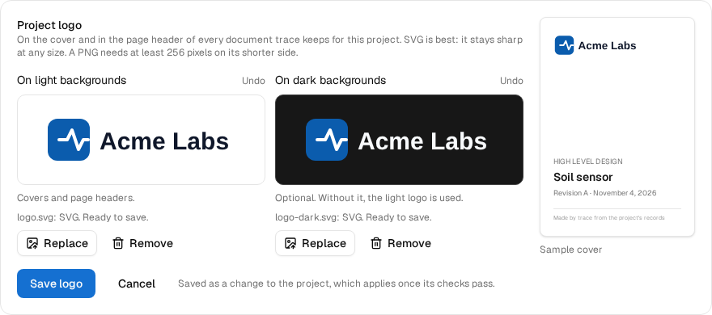

| No logo yet | A file trace refuses | Dark theme | Phone |
|---|---|---|---|
| 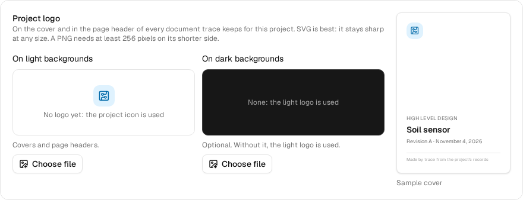 | 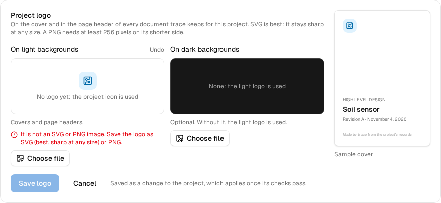 | 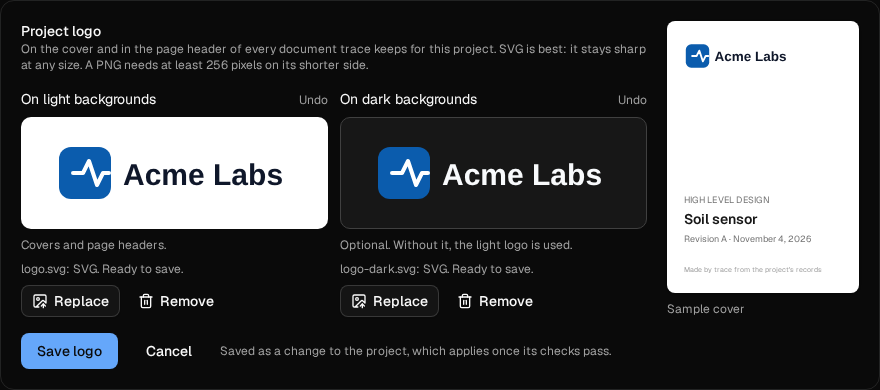 | 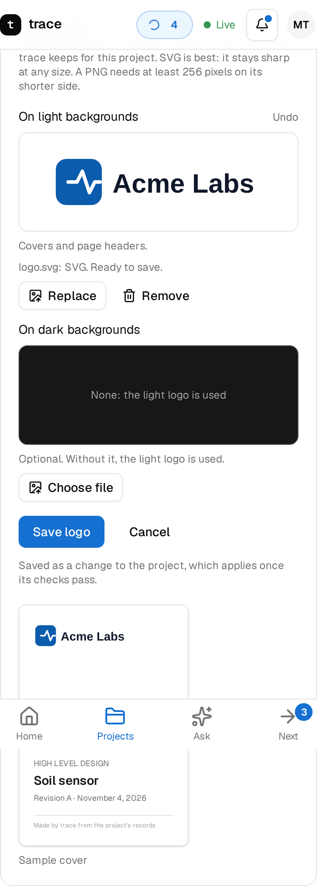 |

## Build contract (the stack)

Each layer is one pull request that builds and passes on its own.

1. **Foundations** (merged, #242): this note; `src/docs/catalog.ts` (documents, sections, sources, figure and value
   kinds, writing rules, the skeleton each document starts from); `src/docs/markers.ts` (section, figure and value
   markers: read, replace one section); `src/docs/diagrams.ts` (which diagrams each document allows and how each is
   made); `src/docs/checks.ts` (the quality bar). Pure functions, no I/O.
2. **Ontology** (merged, #244): the documentation module (`ontology/trace-docs.ttl`, `src/ontology/docs.ts`; docs/ontology.md
   "Documentation module"): document, section, figure, stated value with its basis, published copy and logo, read from
   the documents' markers into the project's graph, so they go stale through the same lineage as everything else.
3. **Logo** (merged, #246): the checks (`src/docs/logo.ts`), `project.logo`, `project.logo_check` and `project.logo_set`
   (`src/api/actions-logo.ts`), and Settings › Documents with the sample cover (`web/src/components/project/project-logo.tsx`).
4. **Render pipeline** (merged, #254): `docs.check` and `docs.publish`, the `docs` job kind on the tools function, and
   `python/tracebridge/docs` (Mermaid to SVG, pandoc to Typst, Typst to PDF with the cover).
5. **Figures and values** (merged, #257): `docs.values` (`src/docs/values.ts`: the power budget per rail, junction temperatures
   from thermal.check with their margins, bench readings from thermal.measure, each with its basis and source, as
   ready tables; nothing records loads yet, so load rows stay pending) and `docs.figures` (`src/tools/docs/figures.ts`):
   the photographic renders from `render.showcase` (docs/revision-renders.md: the board from above, below and
   three-quarter, and in its case and exploded once mech.build made a case, coloured from the logo, draft or release
   quality); the case's three dimensioned views and its parts drawn apart as line drawings (`python -m tracebridge.mech
   drawing`, a cad job); a timing diagram per protocol modelled. Figures go to `docs/design/figures` with stable names
   and `figures.json` (each one's run, inputs hash and quality), so an unchanged figure is never made again and a draft
   is replaced only by a release. Blender renders with Cycles: Eevee cannot run on the tools function (no display).
6. **Scribe** (merged, #264): the `docs` specialist (`src/agents/docs`: label `agent:docs`, its prompt in the catalog from its
   definition) and its tools (`src/tools/docs/scribe.ts`): `docs.init` starts the documents a stage needs,
   `docs.stale` names the sections a change touched (its files, and the project database compared table by table),
   `docs.write_section` writes one section between its markers only when it passes the quality bar. As a specialist it
   has no file tools of its own; the worker commits its documents as a change stacked on the one documented.
7. **Events and gates** (merged, #267): Scribe started by a push that changed a record (`hook.docs`) and by a gate opening a stage
   that needs documents (`gate.sign`); `docs.stale` compares with the documents' own last commit; `docs.check` recorded
   as a run and the release gate's documents criterion (`signoff.docs`).
7b. **Publishing** (merged, #269): `docs.publish` keeps PDFs in the central bucket (`src/docs/printed.ts`) and, with
   `release`, a revision's release copies; a revision cut starts Scribe on them (`docsReleaseRequest`); `documents.get`
   and `documents.pdf`; the nightly drift check (`hook.projects`, `hook.drift`, the hooks function's schedule).
8. **Documents tab** (this layer): `/p/:id/docs` from Architect on (`web/src/routes/_app/p/$id/docs.tsx`,
   `web/src/components/docs`), shown below. `documents.get` now says how current each document is and why, and each
   document's newest print (`documents/latest.json`, which `docs.publish` keeps).
9. **Proof** (in progress): `test-esp32` through every stage on the live installation, checking each document and
   figure as it appears (the I2C display exercises the protocol specification). What it found so far, and fixed in
   this layer:
   - **Architect, Capture, Prove**: Scribe started on its own at each gate and each merged change, and wrote the high
     and low level design from the records with sources on every table; `docs.check` passes at each stage.
   - **Printing failed on the tools function**: Mermaid's browser died there on every diagram (Chromium on Lambda,
     arm64), and the run blamed the first diagram. Now the browser is tried again with a second set of flags that
     leaves out single-process mode, its own error reaches the run (`dumpio`, never just the last stack frame), and a
     browser that never draws is said to be the browser, not the diagram (`python/tracebridge/docs/publish.py`).
     The same documents print here.
   - **Sections left at the stage before**: a gate signed changes the journey, which is not in the repository, so no
     comparison saw it. `docs.stale` takes `also` (the records the request says changed outside the repository), and
     a gate signed or a revision cut names the journey. Only the Journey section says where the project is (a new
     writing rule); the Overview follows the board (its hero render) and the Firmware section the pin plan and
     protocol specs.
   - **Diagrams too small to read when printed**: a writing rule keeps diagrams of more than five boxes top to
     bottom with short labels.

### The Documents tab

A card per document, with how current it is in a word and an icon (never colour alone):

| State | When |
|---|---|
| **Current** | Nothing it is written from changed since the commit it was written at |
| **Behind** | A record it is written from changed since (GitHub's comparison, the project database table by table), or a section due by the stage is still pending; the card says which, in a sentence |
| **Updating** | Behind, and the Documentation agent is working on the project (its card at the top opens its log) |
| **Not written** | The stage needs it and it is not there yet |
| **From <stage>** | Not needed yet; the protocol specification once the design has an interface |
| **Not compared** | Written, but its commit could not be compared with the default branch |

Each written document shows its revision, day and commit, its sections written, **Open the PDF** (its newest print,
"from an earlier text" when the print is older than the text) and **Read the text** (the markdown). Below, each
revision's release copies, newest first, open or download one by one. The line at the top says when trace next checks,
in the viewer's own time. PDFs open in the file viewer, read by their hash (`documents.pdf`); a printed copy has no link
of its own and no versions.

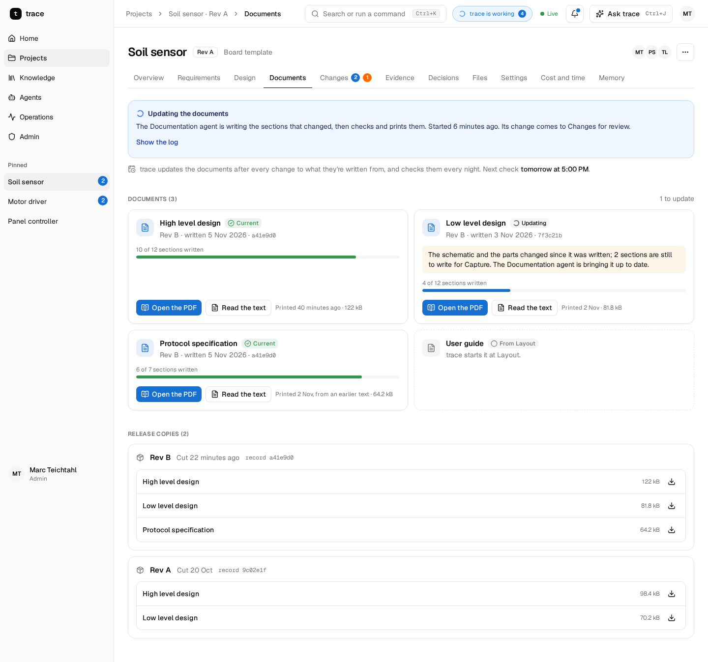

| A print open | Dark theme | Phone | A project at Architect |
|---|---|---|---|
| 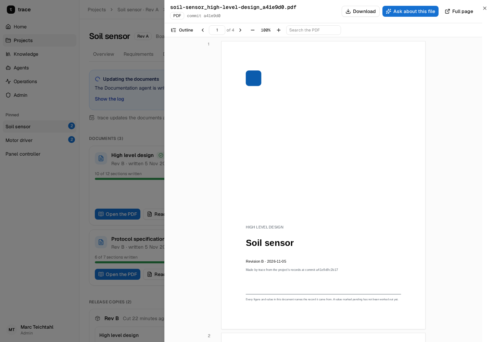 | 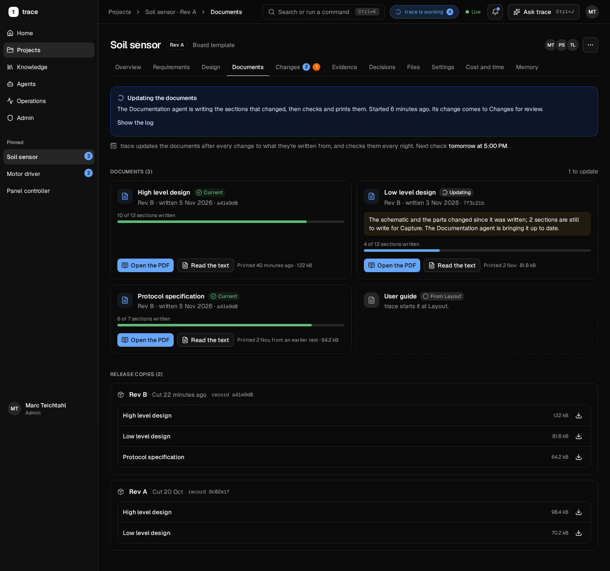 | 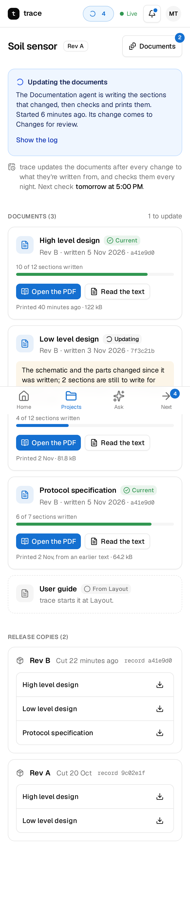 | 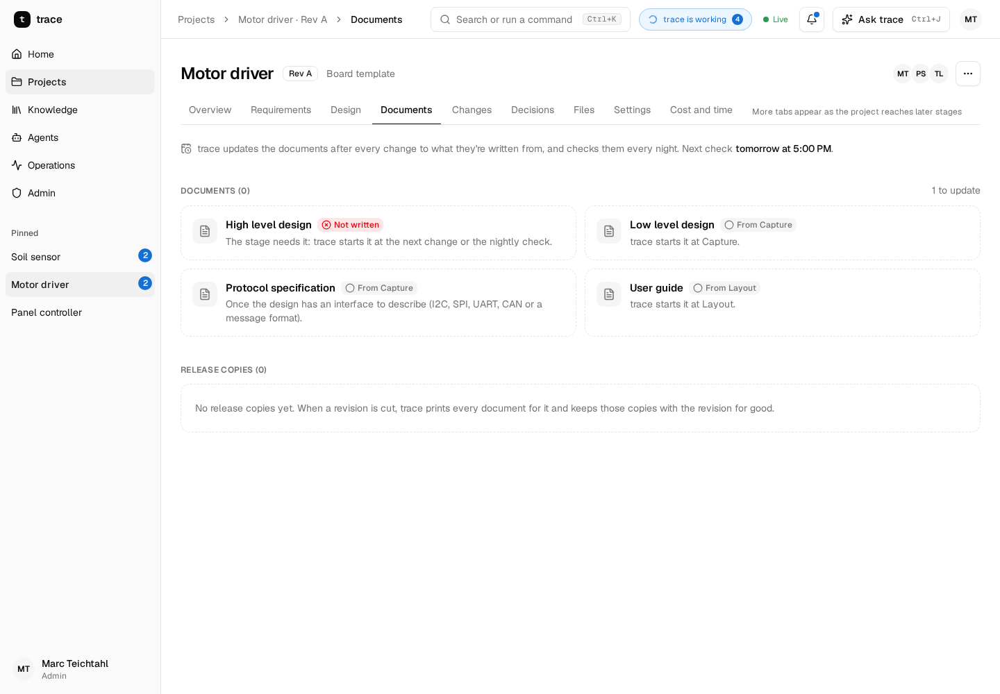 |

### Markers

```markdown
<!-- scribe:section id="power-budget" -->
## Power budget
…
<!-- scribe:end id="power-budget" -->

<!-- scribe:figure kind="render-top" source="run:r-8f2c" -->


<!-- scribe:values kind="power" -->
| Quantity | Value | Limit | Margin | Basis | Source |
|---|---|---|---|---|---|
| 3.3 V rail current | 182 mA | 500 mA | 64 % | simulated | run:r-91aa |
| Battery life | pending | | | pending | |
```

A section whose body is only `_Pending: <what it needs>._` is pending. A figure marker is followed by its image or its
```` ```mermaid ```` block, then a caption line in italics.

### A printed document

The sample high level design printed by `docs.publish` (logo, a Mermaid data flow drawn as text, a stated-value table
and a figure with its caption):

| Cover | A page |
|---|---|
| 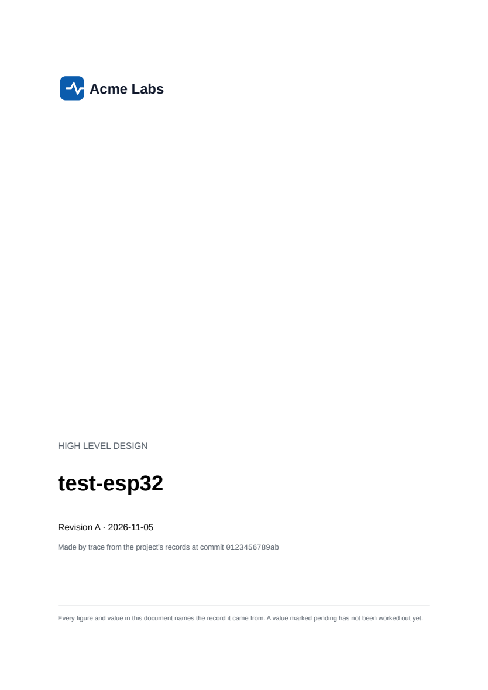 | 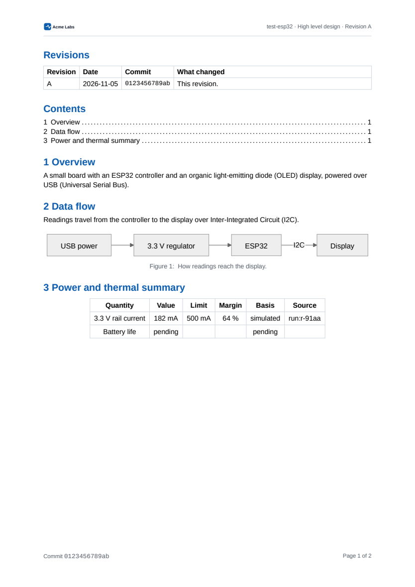 |

### The case's drawings

From the sample case the enclosure engine builds (`python -m tracebridge.mech drawing`): three views in third-angle
projection with the overall size dimensioned, and the parts drawn apart.

| Three views | Exploded |
|---|---|
| 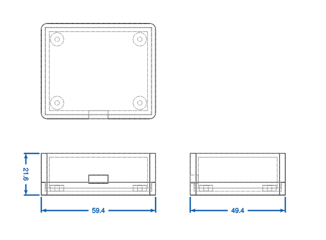 | 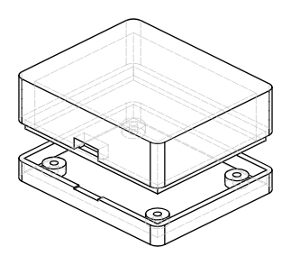 |
