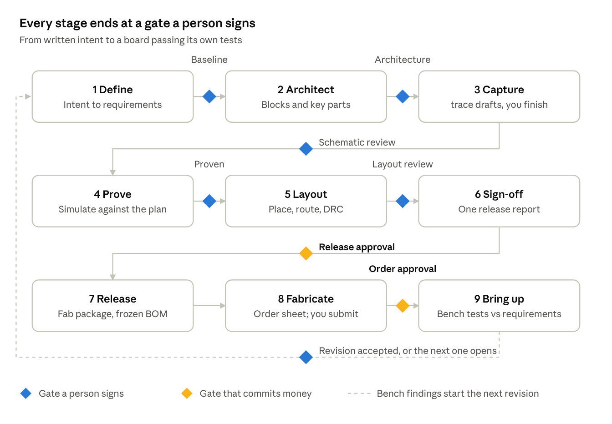
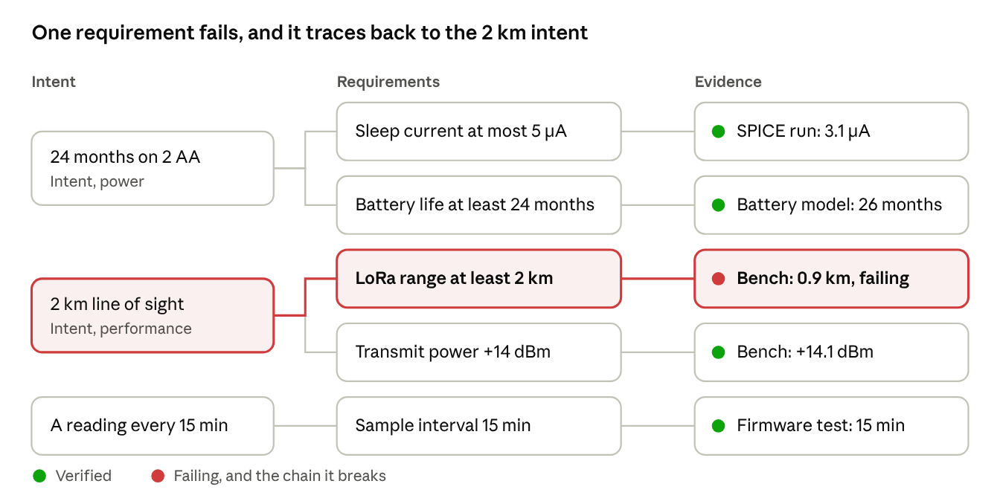
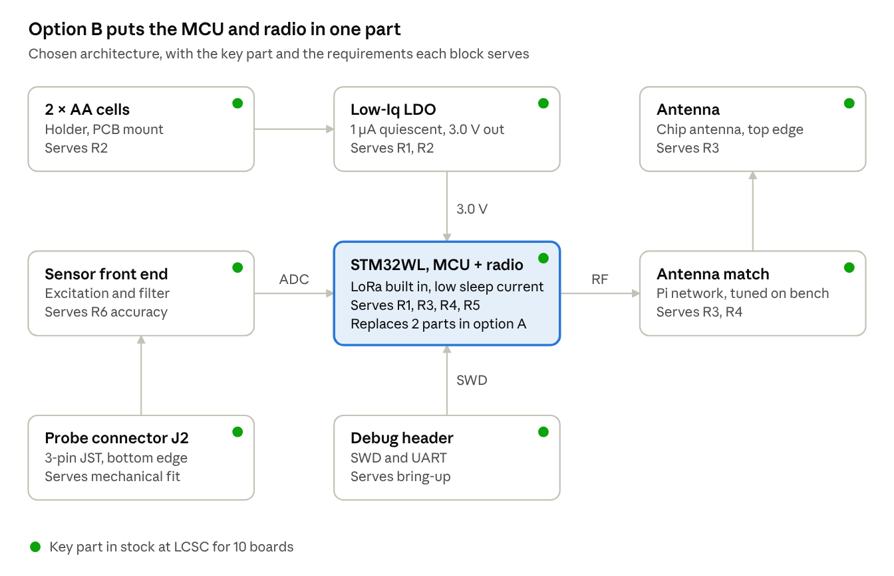
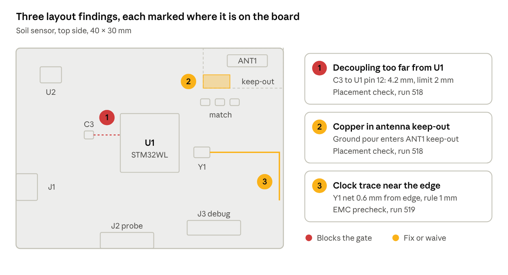
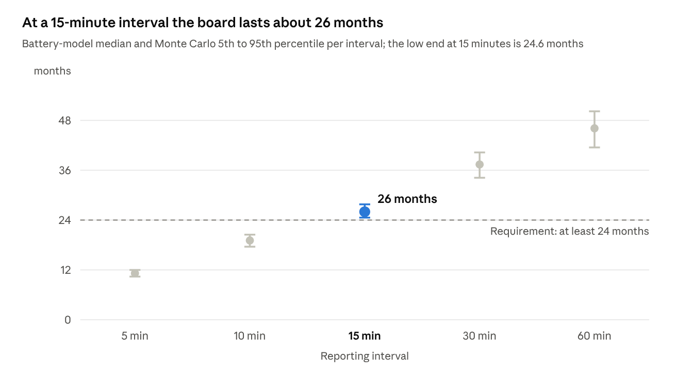
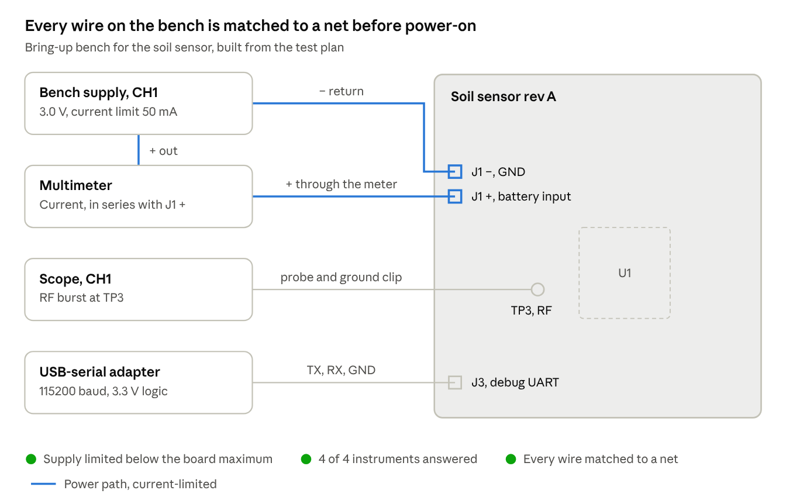

# trace: user journey from definition to fabrication

Oct 27, 2026 · @Marc Teichtahl

A trace project moves through nine stages, from a written intent to a board running its own tests on the bench, and every stage ends at a gate a person passes. The agents do the measuring; people make the calls that cost money or cannot be undone.

## Who uses it and how it behaves

Three roles, mapped onto trace's existing permission classes:

| Role | Permission class | What they do in the journey |
| --- | --- | --- |
| Owner | admin | States the intent, signs every gate, approves spend (the order) |
| Contributor | user | Captures schematics, places parts, answers agent questions, raises issues |
| Reviewer | guest | Reads the design record, comments at gates, never changes the design |

Principles the journey follows:

1. **One record.** Requirements, decisions, runs and evidence live in the project database. Every screen is a view of it; nothing lives only in a chat.
2. **Evidence, not claims.** A stage is done when its gate criteria are measured, each linked to a run id. An agent's opinion never passes a gate.
3. **People decide, agents prepare.** Agents propose and measure; a person approves requirements, architecture, the layout, the release and the order. Every task a person does runs through a guided skill that enforces a minimum quality bar.
4. **Every requirement is traceable.** From the line in the brief, through the part and the net, to the test that proved it on the bench.
5. **Going back is normal.** A failure at any stage reopens the earliest stage it touches, and the record shows why.
6. **The user is told only when it matters.** A gate is ready, an agent is stuck, or a decision is needed. Everything else is in the record.

## The journey at a glance

*the journey · 9 stages, 8 gates*

Stages 1 to 6 are where the design changes; from Release on, the design is frozen and the gates commit money. Bench findings loop back as a new revision rather than edits to the released one.

## Stage by stage

Each stage lists what the person does, what trace does, what the person sees, and the gate that closes it. Tool names are the ones trace has today.

### 1. Define

- **Person:** writes the intent in plain words (what it does, where it lives, power, interfaces, size, cost, quantity) and attaches any specs or reference datasheets.
- **trace:** the Verification agent extracts candidate requirements (`verify.requirements extract`), the AMS agent drafts analog specs (`ams.spec`), and each asks about gaps: missing limits, conflicting numbers, untestable wording.
- **Sees:** a requirements list, each with kind, acceptance criterion and source line, marked proposed or accepted.
- **Gate, requirements baseline:** every requirement accepted or struck, each has a measurable criterion, and the owner signs.

### 2. Architect

- **Person:** chooses between architectures the agents propose, or sketches one.
- **trace:** proposes a block diagram, sizes the key circuits (`calc.*`), picks candidate parts (`parts.search`, `parts.lookup`), pulls their datasheets into the library, and checks stock and lifecycle. Key parts follow the same in-stock order as Capture: in stock at JLCPCB/LCSC for the build quantity, then in stock elsewhere, and only then out of stock, with the reason written on the part.
- **Sees:** the block diagram, a key-parts list with price, stock and lifecycle, and the trade-offs between options.
- **Gate, architecture review:** blocks and key parts approved; every requirement maps to at least one block; every key part in stock for the build quantity or its exception signed.

### 3. Capture

- **trace:** drafts the schematic from the approved architecture: one sheet per block, parts from the key-parts list with MPN and LCSC fields filled, and every other part chosen in stock first, in the same order as key parts: in stock at JLCPCB/LCSC for the build quantity, then in stock elsewhere, and only then out of stock, with the reason written on the part, support circuits sized with `calc.*`, and each sheet annotated with the requirements it serves.
- **Person:** finishes and corrects the sheets in KiCad and pushes them. trace re-checks every push: ERC, each part's use against its datasheet limits (cited by page), missing fields, and BOM cost.
- **Sees:** the drafted sheets, then a review list per sheet: what the person changed from the draft, ERC findings, datasheet conflicts, BOM gaps, and any part not in stock with an in-stock alternative (parts.alternatives).
- **Gate, schematic review:** ERC clean or waived with a reason, no open datasheet conflicts, every part in stock for the build quantity (parts.bom\_check) or its exception signed.

### 4. Prove

- **Person:** reviews results and waives what cannot be simulated.
- **trace:** writes the test plan (`verify.plan`) and runs it: SPICE, corners and Monte Carlo yield, op-amp stability and noise (`ams.*`), logic and formal checks for any HDL (`verify.*`), and FPGA synthesis and timing (`fpga.*`).
- **Sees:** the coverage matrix, requirement by requirement: verified, failing, untested or waived, each linked to its run.
- **Gate, design proven:** every pre-layout requirement verified or waived; no failing item.

### 5. Layout

- **Person:** sets the outline, stackup and fixed parts (connectors, mounting holes, anything mechanical), then adjusts trace's placement.
- **trace:** proposes a placement from the floorplan (blocks grouped, decoupling at its pins, connectors on the edge), re-checks the person's adjustments (`pcb.placement_check`), routes (`pcb.autoroute`: OrthoRoute for the dense core, then Freerouting), matches lengths, runs DRC with schematic parity, and renders the board.
- **Sees:** the proposed placement as a render and an overlay, then the routing report, unrouted count, DRC and length-match findings.
- **Gate, layout review:** zero unrouted, DRC clean or waived, length groups in tolerance, renders approved.

### 6. Sign-off

- **Person:** reviews the release report and decides.
- **trace:** runs EMC prechecks and, where warranted, an openEMS model (`emc.*`), checks signal integrity, re-runs the whole plan on the final files, and checks the BOM for the build quantity (`parts.bom_check`).
- **Sees:** one release report: coverage, EMC pre-compliance estimates, BOM cost and stock for N boards, open waivers.
- **Gate, release approval:** the owner approves. This is the last point where change is cheap.

### 7. Release

- **Person:** nothing beyond approving.
- **trace:** builds the fabrication and assembly package (`kicad.fab`: Gerbers, drill, BOM, placement, JLCPCB files), freezes a BOM snapshot with prices, tags a release, and stores it all as one artifact set.
- **Sees:** the release, with its files, its revision and the report that approved it.
- **Gate:** none; the package is a product of the approval.

### 8. Fabricate

- **Person:** signs the order gate, then uploads the package and pays on JLCPCB's site, and records the order number in trace.
- **trace:** prepares everything JLCPCB needs (Gerbers, BOM and CPL in its columns, board options), re-checks LCSC stock and price on the day, and tracks the order once its number is recorded.
- **Sees:** an order sheet with the files, options, expected cost and any stock change since sign-off; then the order's status.
- **Gate, order approval:** an admin signs before the files are handed over. trace never pays.

### 9. Bring up

- **Person:** puts the board on the bench and wires the instruments.
- **trace:** steps through a bring-up checklist with current-limited supplies (`hil.psu`), builds and flashes firmware (`firmware.*`), runs the plan's hardware items (`hil.*`), and records results against requirements.
- **Sees:** the same coverage matrix, now with bench evidence, and any failures turned into issues routed to a specialist.
- **Gate, revision accepted:** every requirement verified on hardware or carried to the next revision as an issue.

## Across every stage

**The design record.** One project page holds the stage the project is in, the next gate and what it still needs, the requirements with their status, open questions for people, and the run history. Each gate leaves a signed snapshot: who approved, when, the evidence, and the waivers taken.

**Revisions.** A release starts a revision (rev A, rev B). Bring-up findings open the next one, and requirements, waivers and test results carry forward so nothing is re-proven by hand.

**Gates are hard.** No work in a stage starts until the gate before it is signed; agents queue the next stage's work but do not run it. Any admin may sign a gate, with one signature, and the signature records who, when, the evidence and the waivers.

**Templates.** Each project starts from a template that keeps only the stages it needs: board (all nine), FPGA (no Capture or Layout; Prove covers synthesis and timing, Release is a bitstream), firmware (Define, Architect, Prove, Release, Bring up) and mixed (all nine, with FPGA and firmware items in Prove).

**Going back.** Any failure reopens the earliest stage it touches:

| Found at | Typical cause | Reopens |
| --- | --- | --- |
| Prove | Circuit misses a spec at a corner | Capture, or Architect if a part must change |
| Layout | Cannot route, or EMC precheck fails | Layout, or Capture for a pinout or part change |
| Sign-off | A key part goes out of stock or end of life | Architect, with `parts.alternatives` as a starting point |
| Fabricate | Stock gone on order day | Sign-off, with a substitute re-proven |
| Bring up | A requirement fails on the bench | The stage the root cause lives in, as a new revision |

**Asking people.** Agents ask through the project's issues and the web app, never by stopping silently. A question names what it blocks, offers options where it can, and cites what it already read (knowledge base, datasheets). A gate never opens on a timeout.

**Notifications.** The person hears about four things only: a gate is ready to review, an agent is stuck, a question blocks progress, and money is about to be spent.

**Visuals.** Wherever a picture can show what words describe, trace shows it, and a person can ask for one at any point ("show me the power sheet", "render the bottom side"). Skills open with the visual for their step, findings point at a place on a picture rather than a coordinate, and every image is stored with the run that made it, so it is evidence like any other. Slow images (photographic renders, turntables) are made when asked or at a gate, never on every push.

| Stage | Shown by default | On request | Made by |
| --- | --- | --- | --- |
| Define | Requirements traced to the intent | A requirement's source page from a spec or datasheet | `datasheets.page_image`; traceability view (new) |
| Architect | Block diagram per option; key parts side by side | Datasheet figures for a part; a comparison chart of the scores | Block diagram (new); `datasheets.page_image` |
| Capture | Each drafted sheet, with notes and findings marked on it | Any sheet; a part's datasheet figure beside its symbol | `kicad.export` (sch\_svg, sch\_pdf); finding overlays (new) |
| Prove | Waveforms and sweep plots per test; the coverage matrix | Any run's waveforms; corner and Monte Carlo spreads | Plots from `sim.*` and `ams.*` run data (new) |
| Layout | Placement by block; DRC and placement findings on the board | Top and bottom renders; a single net highlighted; a 3D view | `kicad.export` (pcb\_svg, render); `render.board` |
| Sign-off | Release report with coverage and EMC charts | Photographic renders; a turntable; field plots | `render.board`, `render.turntable`; `emc.run` output |
| Release | Board renders stored with the release | The Gerber layers as images | `render.board`; `kicad.export` |
| Fabricate | The order sheet with board renders | JLCPCB's preview beside trace's render | `render.board` |
| Bring up | Wiring diagram for the bench; scope captures per step | Any capture or measurement plotted against its limits | `hil.scope_capture`; bench wiring view (new) |

Most images come from tools trace already has; the rows marked new (traceability, block diagrams, finding overlays, plots from run data, the bench wiring view) need building; each is specified, with an example, in the next section.

## The five new visuals

Each new visual is specified below with an example drawn for the soil sensor from the walkthrough. The examples are illustrative: the parts, values and findings are made up to show the shape of each view.

### Traceability view

The traceability view shows every requirement between the intent it came from and the evidence that proves it, so a person can follow any line from a sentence in the brief to a run on the bench. It is the main view in Define and the backbone of every gate.

- **Columns:** intent statements, requirements, evidence. Waivers and test items appear in the evidence column with their own marks.
- **Status:** each evidence box is verified, failing, untested or waived; a failure colours its whole chain back to the intent, so the person sees what promise is at risk.
- **Interaction:** tap any box to open its source (the intent line, the requirement record, the run with its plots); filter to one stage, one kind or one status.
- **Data:** the `requirements`, `test_items` and `test_results` tables, plus a new link from each requirement to its intent line.

*traceability view · soil sensor rev A, illustrative*

In the example, the bench range test fails and the chain lights up back to "2 km line of sight": that is the intent the next revision has to keep.

### Architecture block diagram

The block diagram is how the Architecture choice skill shows each option, and the map trace drafts the schematic from. One diagram is drawn per option, in the same layout, so options can be compared side by side.

- **Each block shows:** its name, the key part with its stock status, and the requirements it serves.
- **Each connection shows:** what flows along it (a rail and its voltage, a bus, an RF path).
- **Interaction:** tap a block for the part's datasheet, price breaks and alternatives; tap a requirement to jump to its traceability chain; switch between options with the layout held still.
- **Data:** a new architecture record in the project database (blocks, connections, key parts, requirement mapping), written by the architecture step and read by schematic drafting, which turns each block into a sheet.

*architecture block diagram · soil sensor option B, illustrative*

A requirement served by no block, or a key part not in stock, shows on the diagram before the architecture gate, not after.

### Findings marked on sheets and boards

Every finding from ERC, DRC, the placement check, the datasheet-limit check and the EMC precheck is drawn where it is, on the schematic sheet or the board, with a numbered marker that matches its entry in the list beside it. A person fixes what they can see instead of hunting for a coordinate.

- **On sheets:** the symbol, pin or net is circled; a datasheet conflict links to the cited page image.
- **On boards:** the part, track, zone or gap is marked, with the measured distance drawn when the finding is a distance.
- **Severity:** findings that block the gate are red; findings that must be fixed or waived are amber; waived findings stay visible but grey.
- **Interaction:** tap a marker or a list entry to zoom to it; after the next push, fixed findings fade out and new ones appear.
- **Data:** the findings trace already records with each run (type, location, items, evidence), drawn over the `kicad.export` SVG of the sheet or board layer.

*findings overlay · soil sensor board, illustrative*

In the example, finding 1 blocks the layout gate; findings 2 and 3 can be fixed or waived through the Waiver skill.

### Plots from run data

Every simulation and measurement run gets a plot drawn from its own recorded data, with the requirement it is judged against drawn on it. The person reads the verdict and the margin at a glance, and the plot stays with the run as evidence.

- **Plot types:** waveforms (transient runs, scope captures), sweeps (one value against a parameter), spreads (corners and Monte Carlo as a median with a range), Bode plots (op-amp loop gain), and spectra (EMC estimates against the CISPR limit line).
- **Always on the plot:** the limit or target from the requirement, the margin to it, and the run id.
- **Interaction:** hover a point for its value and conditions; tap it to open the run; overlay the same plot from an earlier revision to see what changed.
- **Data:** the measurements trace already stores with each run (`sim.*`, `ams.*`, `hil.*`), with the requirement's acceptance criterion as the reference line.

*battery-life model and Monte Carlo sweep · soil sensor rev A, illustrative values*

In the example, even the low end of the Monte Carlo spread at the chosen 15-minute interval stays above the requirement; a 10-minute interval would fail it.

### Bench wiring view

The bench wiring view is how the Bench setup skill shows the person what to connect, and the record of how the bench was wired when the results were taken. trace builds it from the test plan's hardware items and the bench configuration.

- **Shows:** each instrument with its settings, each wire with what it carries, and each connection point on the board by its reference and net (connector pin or test point).
- **Safety marks:** power paths are drawn apart from signal wires and carry their current limit; a supply without a limit cannot be drawn as connected.
- **Checks:** the three Bench setup checks appear under the drawing and tick as each passes: supply limits set, every instrument answered its identity query, every wire matched to a net.
- **Interaction:** tap a connection point to see it on the board render; tap an instrument for its saved settings; the person ticks each wire as connected.
- **Data:** the bench configuration (`hil.instruments`, `hil.serial`, `hil.can`), the test plan's hil items and the board's net and test-point list; a new record links each wire to a net.

*bench wiring view · soil sensor rev A bring-up, illustrative*

The view is stored with each bring-up run, so a later reader knows exactly how the board was wired when a result was taken.

## Guided skills for every person's task

Every task a person does is run by a skill that guides them through it and will not accept the result until it meets a minimum quality bar. The bar is checked by a tool that returns pass or fail with the reasons, never by the model's opinion; what passes is written to the project database, and what fails says exactly what is missing.

| Skill | Stage | Guides the person through | Will not submit until |
| --- | --- | --- | --- |
| Intent builder | Define | Writing the product intent | Every item below is answered (spec follows the table) |
| Requirements review | Define | Accepting, editing or striking each proposed requirement | Each accepted requirement has one testable criterion with number and unit, a kind and a source; no duplicates or conflicts left open |
| Architecture choice | Architect | Comparing the proposed architectures and picking one | Each option was scored on the same criteria; the choice states why; every requirement maps to a block |
| Schematic finish | Capture | Correcting and completing trace's drafted sheets | Every change from the draft has a reason; ERC run on the final push; no part without MPN and LCSC fields |
| Waiver | Any | Waiving a requirement, finding or check | States the reason, the risk if wrong, and where it will be verified instead (a later stage or the bench) |
| Board setup | Layout | Outline, stackup, mounting and fixed parts | Outline closed; stackup has layer count, thickness and copper weights; each fixed part has a mechanical reason |
| Placement adjust | Layout | Moving parts trace placed | Each move has a reason; placement check passes, or its findings are waived |
| Gate signing | Every gate | Reviewing the evidence before signing | Every criterion shows its evidence run; every waiver taken at this stage has been opened and acknowledged |
| Release review | Sign-off | Reading the release report | Coverage, EMC estimates, BOM cost and stock and open waivers each acknowledged |
| Order submit | Fabricate | Placing the order on JLCPCB | The options entered match the order sheet; the order number and paid cost are recorded |
| Bench setup | Bring up | Wiring instruments and buses | Each power supply has voltage and current limits; every instrument answers its identity query; wiring matches the plan |
| Bring-up run | Bring up | Powering up and running the hardware tests | Each power-on step passed its limits before the next; every failure is recorded as an issue |
| Question answer | Any | Answering a question an agent raised | The answer is specific enough to unblock the agent, and cites its source when it is a fact |

### Intent builder

The intent builder is a conversation, not a form. It asks one topic at a time, reflects back what it heard as draft statements, and pushes back on vague answers. The person can stop and return; the draft is kept.

Topics it covers, in order:

1. **Purpose:** what the product does, in one sentence, and who uses it.
2. **Environment:** operating and storage temperature, enclosure, ingress protection, vibration, where it is installed.
3. **Power:** source, input voltage range, power budget, battery life if any, behaviour on brown-out.
4. **Interfaces:** each one with type, connector, protocol, rate and direction.
5. **Performance:** the numbers that define success (accuracy, latency, resolution, range, throughput).
6. **Physical:** board size limits, mounting, height, connector positions.
7. **Compliance:** target standards and class (for example CISPR 32 class B), safety, markings.
8. **Build:** quantity per run, target unit cost, assembly preference.
9. **Constraints:** parts or vendors that must be used or avoided, reuse of earlier designs.
10. **References:** attached specs, datasheets, sketches, prior boards.

Quality bar, all checked before the intent can be submitted:

- Every topic is answered or explicitly marked "don't care", or "unknown, decide by" a named stage.
- Every quantity has a number and a unit; ranges have both ends.
- No vague words stand alone: "fast", "small", "low power", "robust" and similar are flagged until a number replaces them.
- Every interface is fully specified (type, connector, protocol, rate, direction).
- No internal conflicts: the power budget fits the source, the size fits the connectors, the cost fits the quantity.
- Each statement can become a testable requirement; those that cannot are flagged for rewording.
- Open questions are listed with an owner.

What it produces: the intent document in the project record, and the candidate requirements that open Requirements review.

### Requirements review

The skill walks the person through trace's candidate requirements one at a time, each shown beside the intent line or spec page it came from. For each, the person accepts, edits, merges or strikes it; the skill rewrites vague wording with them until it can be tested.

Steps:

1. **Read the source:** the candidate is shown with the sentence or table row it was drawn from.
2. **Decide:** accept, edit, merge with another, or strike with a reason.
3. **Make it testable:** one criterion per requirement, with a number, a unit, the conditions it holds under, and the method that will verify it (sim, formal, spice, hil, inspection, drc).
4. **Classify:** kind (functional, electrical, timing, emc, mechanical) and priority (must or should).
5. **Resolve conflicts:** the skill pairs requirements that cannot both hold (a power budget and a battery life, a size and a connector count) and asks which one gives.
6. **Cover the intent:** every intent statement maps to at least one requirement, or is marked as covered by none, with a reason.

Quality bar:

- Every accepted requirement has exactly one testable criterion with number, unit, conditions and verification method.
- No two accepted requirements conflict or duplicate each other.
- Every requirement cites its source (intent line, spec page or person).
- Every intent statement is covered or explicitly left out with a reason.
- Struck requirements keep their reason, so a later review can see why.

Produces: the requirements baseline in `requirements`, ready for the baseline gate.

### Architecture choice

The skill sets two or three proposed architectures side by side and has the person score each against the same criteria before choosing. It will not let a choice be made on a single criterion, or on one that was not stated before scoring started.

Steps:

1. **Agree the criteria:** start from cost, risk, part availability, power, size and schedule; the person adds, removes or weights them before seeing any scores.
2. **Read each option:** block diagram, key parts with stock and price, how each requirement is met, and the risks trace sees.
3. **Score:** each option on each criterion, with a one-line reason per score.
4. **Choose and state why:** the choice and the deciding criteria, in the person's words.
5. **Map:** confirm every requirement maps to a block in the chosen option; unmapped ones go back to Requirements review or get a block.
6. **Accept the key parts:** each key part follows the in-stock order, or its exception is written.

Quality bar:

- At least two options were compared, unless the person states why only one is possible.
- Criteria and weights were fixed before scoring.
- Every score has a reason; the choice names the criteria that decided it.
- Every requirement maps to at least one block.
- Every key part is in stock for the build quantity or carries a written exception.

Produces: the chosen architecture, the decision record with rejected options, and the key-parts list.

### Schematic finish

The skill takes the person sheet by sheet through trace's drafted schematic, pointing at what the draft left for a person and what it was unsure of. Every push is re-checked, and the skill shows what the person changed from the draft so each change carries its reason.

Steps:

1. **Walk each sheet:** the block it implements, the requirements it serves, and trace's open notes (assumptions, values it could not size, parts it was unsure of).
2. **Resolve the notes:** confirm, correct or replace each one.
3. **Edit in KiCad and push:** trace re-runs ERC, the datasheet-limit check and the BOM check on every push.
4. **Explain the changes:** every difference from the draft (part swapped, value changed, net added) gets a one-line reason.
5. **Clear the findings:** fix or waive each ERC finding and each datasheet conflict (through the Waiver skill).
6. **Check sourcing:** every part has MPN and LCSC fields and follows the in-stock order.

Quality bar:

- No draft note left open.
- Every change from the draft has a reason.
- ERC run on the final push: clean, or each finding waived.
- No datasheet conflict open; each cites its page.
- Every part has MPN and LCSC fields, and is in stock for the build quantity or carries an exception.
- Every sheet names the requirements it serves.

Produces: the finished schematic at a recorded commit, with its change log against the draft, ready for the schematic gate.

### Waiver

The skill runs whenever a person wants to set aside a requirement, a check finding or a test. A waiver is a decision to accept a risk, so the skill makes the person state the risk and where it will be caught instead.

Steps:

1. **Name what is waived:** the requirement, finding or test item, shown with its evidence.
2. **Give the reason:** why it cannot or need not be met or checked now.
3. **State the risk:** what goes wrong if the reason is mistaken, and how bad that would be (cosmetic, degraded, failure, safety).
4. **Say where it is caught instead:** a later stage, a bench test, or nowhere (accepted for good).
5. **Set the scope:** this revision only, or until a named condition changes.

Quality bar:

- Reason, risk and severity are all given; "not needed" alone is refused.
- A waiver rated safety must name where it is verified instead; it cannot be accepted for good.
- Every waiver names its scope.
- A waiver with a later check creates that check as a test item in the plan.

Produces: a waiver record linked to what it waives; it is listed at every later gate until it closes.

### Board setup

The skill sets up everything trace's placer needs before it can place: the outline, the stackup, the mounting and the parts whose position is fixed by the mechanics. It draws the answers from the intent's physical section and asks only for what is still open.

Steps:

1. **Outline:** size and shape from the intent, corner radii, cut-outs and keep-out zones.
2. **Stackup:** layer count, board thickness, copper weights and dielectric, chosen from JLCPCB's standard stackups unless there is a reason not to; trace shows the impedance each gives for the controlled-impedance nets (`calc.impedance`).
3. **Mounting:** hole positions, sizes and clearances.
4. **Fixed parts:** connectors, switches, LEDs, displays and anything else whose position the enclosure sets, each with its position and side.
5. **Rules:** minimum track, gap, via and annular ring set to what JLCPCB can build for the chosen options.

Quality bar:

- The outline is a closed shape and matches the intent's size limits.
- The stackup states layer count, thickness, copper weights and dielectric, and every controlled-impedance net has a width that meets its target.
- Every fixed part has a mechanical reason (an enclosure drawing, a panel cut-out or a stated position).
- Design rules are within JLCPCB's capability for the chosen options.

Produces: the board file with outline, stackup, rules and fixed parts, ready for trace to place the rest.

### Placement adjust

The skill presents trace's proposed placement as a render with an overlay of blocks, critical nets and its placement findings, and guides the person through moving what is wrong. Each move is re-checked at once so the person sees what it fixed or broke.

Steps:

1. **Review by block:** each block's group, its critical parts (regulators, crystals, high-speed interfaces) and trace's reasons for where they sit.
2. **Check the critical items:** decoupling at its pins, crystal near its pins, switching loops tight, connectors on the edge, thermal parts with room to shed heat.
3. **Move parts in KiCad and push:** the placement check and floorplan re-run on every push.
4. **Explain the moves:** each moved part gets a one-line reason (mechanical, thermal, routing, assembly).
5. **Lock:** the person locks what must not move before routing starts.

Quality bar:

- Every moved part has a reason.
- Placement check passes: no courtyard overlaps, nothing outside the edge or in a keep-out, decoupling within distance; or each finding is waived.
- Fixed parts from Board setup have not moved.
- Parts the router must not move are locked.

Produces: the placed board at a recorded commit, ready for autorouting.

### Gate signing

The skill runs at every gate. Because gates are hard and need only one admin's signature, it is the only check before work moves on, so it makes the signer open the evidence rather than sign a summary.

Steps:

1. **See the criteria:** the gate's criteria, each marked met, not met or waived by the checker tool.
2. **Open the evidence:** for each criterion, the run or record behind it (a coverage row, a DRC report, a BOM check); the skill records that each was opened.
3. **Acknowledge the waivers:** every waiver taken in this stage, with its reason, risk and where it will be caught.
4. **Note concerns:** anything the signer is uneasy about but will not block on, recorded as a note or an issue.
5. **Sign or return:** sign, or send the stage back with the reasons.

Quality bar:

- The checker tool reports every criterion met or waived; the sign button is disabled otherwise.
- The signer opened the evidence for every criterion and every waiver.
- A return names what must change.
- The signer is an admin on the project.

Produces: the gate record (signer, time, criteria with evidence, waivers acknowledged, notes) and the start of the next stage's work.

### Release review

The skill guides the person through the release report before the release gate, the last point where change is cheap. It reads the report in a fixed order so nothing is skimmed, and ends in Gate signing.

Steps:

1. **Coverage:** every requirement verified or waived, with the waivers listed by severity.
2. **EMC and signal integrity:** prechecks and openEMS estimates against the compliance target, each labelled as a pre-compliance estimate.
3. **BOM:** cost per board and for the build quantity, stock today, lifecycle, and parts with a single source.
4. **Fabrication:** board options, DRC against JLCPCB's capability, assembly coverage (parts JLCPCB can place, parts placed by hand).
5. **Changes since the last revision:** what changed and why, for a revision after the first.
6. **Decide:** release, or return to the stage the concern belongs to.

Quality bar:

- Each of the five areas is acknowledged in turn.
- No requirement is untested; failing requirements block release, and only waivers can stand in.
- Every part with a single source, or not active in lifecycle, is acknowledged.
- The expected cost for the build quantity is stated.

Produces: the approved release report, which the Release stage stores with the package.

### Order submit

The skill guides the person through placing the order on JLCPCB's site, since trace prepares the order but never pays. It works from trace's order sheet and checks that what was ordered matches what was released.

Steps:

1. **Re-check stock:** trace re-checks LCSC stock and price for the build quantity; any change since sign-off is shown, and a part now short sends the project back to Sign-off.
2. **Download the package:** Gerbers, BOM and CPL from the release.
3. **Enter the options:** the skill lists each board option (layers, thickness, colour, finish, copper weight, impedance control, quantity, assembly side) for the person to enter on JLCPCB.
4. **Review JLCPCB's part matching:** confirm each BOM line matched the intended LCSC part, and record any part JLCPCB will not place.
5. **Pay and record:** after paying, the person enters the order number, the paid cost and the quoted ship date.

Quality bar:

- Stock was re-checked on the day of the order and every line is available.
- Every option entered matches the order sheet; the person confirms each one.
- Every BOM line matched the intended LCSC part, or the substitute is acknowledged.
- Order number, paid cost and ship date are recorded.

Produces: the order record, linked to the release; trace tracks it from the order number.

### Bench setup

The skill guides the person through wiring the bench before the first power-on, so trace can drive it safely. It builds the wiring list from the test plan's hardware items and checks each instrument as it is connected.

Steps:

1. **See what the plan needs:** the instruments, buses and probe points the bring-up and hardware tests call for.
2. **Connect and identify:** each instrument is connected and answers its identity query (`hil.idn`); serial and CAN ports are found (`hil.ports`).
3. **Set the supply limits:** voltage and current limits per supply channel, starting from the board's expected draw with a margin, never above the board's absolute maximum.
4. **Wire to the board:** each probe, supply and bus connection matched to its net and test point, confirmed by the person.
5. **Record the bench:** the configuration is saved (`hil.instruments`, `hil.serial`, `hil.can`) so tests reuse it.

Quality bar:

- Every power supply channel has a voltage limit and a current limit, below the board's absolute maximum.
- Every instrument the plan needs answers its identity query.
- Every connection is matched to a named net or test point.
- Hardware use is enabled (`TRACE_HARDWARE=1`) only on this bench machine.

Produces: the saved bench configuration, ready for the bring-up run.

### Bring-up run

The skill steps the person and trace through the first power-on of a new board, one stage at a time, so a fault is caught at the step that exposes it, not after it has damaged something. trace drives the instruments; the person watches, probes and confirms.

Steps:

1. **Inspect:** a visual check for solder bridges, missing or rotated parts and polarity, against the render and placement file.
2. **Unpowered checks:** resistance from each rail to ground, to catch shorts before power is applied.
3. **Power each rail:** one at a time where the design allows, current-limited, with voltage and current read back and compared with the expected values.
4. **Clocks and reset:** oscillators running, reset released.
5. **Firmware:** build and flash (`firmware.*`), then confirm the board talks (serial or CAN).
6. **Run the hardware tests:** the plan's hil items, in order, each recorded as a result against its requirement.
7. **Record failures:** each failure becomes an issue routed to a specialist, with the run evidence attached.

Quality bar:

- Each step passed its limits before the next started; any reading out of limits stops the run.
- No rail was powered with a short reading or without a current limit.
- Every hardware test item has a recorded result (pass, fail, or blocked with a reason).
- Every failure is an issue linked to its requirement and evidence.

Produces: bench results in the coverage matrix and the issues that open the next revision, or the evidence for the revision-accepted gate.

### Question answer

The skill runs when an agent raises a question it cannot answer from the record, the knowledge base or the datasheets. It shows what the agent already looked at and what the question blocks, so the person answers once and in enough detail.

Steps:

1. **See the context:** what the agent is doing, what the question blocks, and the sources it already searched.
2. **Pick or write:** choose one of the agent's options, or write an answer.
3. **Make it specific:** a quantity gets a number and unit; a choice names the option; a fact names its source.
4. **Say whether it lasts:** a one-off answer, or a rule for the project (added to `.trace/rules.md` or the requirements).

Quality bar:

- The answer resolves what the question blocks; "it depends" or "you decide" is refused unless it names what to decide on.
- Quantities have numbers and units.
- A stated fact cites its source.
- An answer that changes a requirement goes through Requirements review rather than straight into the design.

Produces: the answer on the agent's job, and when it lasts, a rule or a requirement change.

trace has none of these skills today. The prompt catalog and Agent Skills are the natural home for the guidance, and each quality bar needs a checker tool that the gate and the skill both call.

## What trace is missing for this journey

trace today is strongest in Prove, Layout and Sign-off; the journey's ends (Define, Architect, Fabricate) and its spine (stages and gates) are thin. Checked against `main` at commit `b2d6f29`.

| Gap | Stage | Today | Needed |
| --- | --- | --- | --- |
| No notion of stage or gate | All | Work is routed per issue or PR; nothing tracks where a project is | A project state machine with hard gates and gate records (signer, date, evidence, waivers) in the project database |
| No project templates | All | One shape for every project | Board, FPGA, firmware and mixed templates, each with its own stages |
| No intent intake | Define | `verify.requirements extract` works from a spec's text by rules | A guided intake that turns a plain-language brief into requirements and questions |
| No architecture agent | Architect | Parts, datasheets and calculators exist; nothing proposes a block diagram or compares options | An architecture step, or a sixth specialist, that writes blocks and maps requirements to them |
| No schematic drafting | Capture | KiCad tools only read and check | Writing KiCad schematic sheets from the architecture: symbols, MPN and LCSC fields, support circuits, net labels. The largest new build |
| No datasheet-limit check | Capture | Datasheet params and part fields are readable | A check of each part's operating point against its datasheet limits, cited by page |
| No placement | Layout | `pcb.placement_check` and `pcb.floorplan` only report | A placer that writes footprint positions from the floorplan, respecting parts the person fixed |
| No release object | Release | `kicad.fab` writes a package to a folder | A release record: revision, package, frozen BOM, approving report, git tag |
| No order preparation | Fabricate | `kicad.fab` writes JLCPCB files | A JLCPCB order sheet (options, expected cost, stock re-check) and order tracking by order number |
| No bring-up checklist | Bring up | `hil.*` and `firmware.*` exist; `verify.plan` supports hil items | A staged power-on sequence with limits and stop conditions, built from the plan |
| No revisions | All | One design, versioned by git only | Revisions that carry requirements, waivers and results forward |

## Decisions

Decided with Marc on 27 October 2026; the stages and gaps above reflect them.

| Question | Decision | What follows |
| --- | --- | --- |
| Who draws the schematic? | trace drafts, a person finishes | Schematic drafting becomes the largest new build |
| Who places parts? | trace proposes, a person adjusts | A placer that respects parts the person fixed |
| How strict are gates? | Hard everywhere | Agents queue the next stage but do not start it |
| Who signs a gate? | Any admin, one signature | No second signature, even on Release and Order approval |
| First fab and assembler | JLCPCB | Builds on the files `kicad.fab` already writes |
| Does trace order? | Prepares only; a person submits and pays | No payment handling in trace |
| Fixed or per-project journey? | Templates per project type | Board, FPGA, firmware and mixed |
