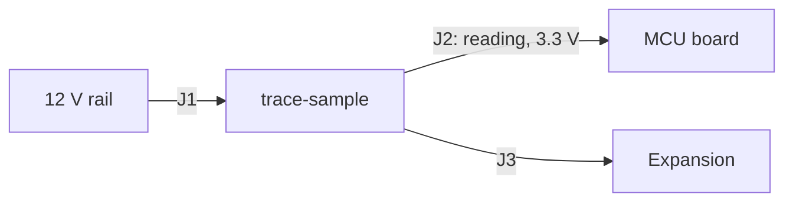
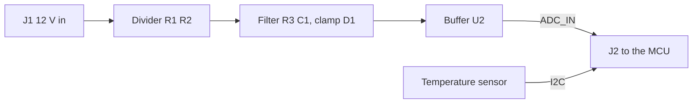

# trace-sample: High level design

<!-- scribe:section id="overview" -->
## Overview

A small board that measures a 12 V supply rail and the board's own temperature and reports both to a microcontroller (MCU) board over a header. It is for a lab technician who wants to log a rail's voltage over a day.
<!-- scribe:end id="overview" -->

<!-- scribe:section id="context" -->
## System context

The board takes the rail it measures at `J1`, makes its own 3.3 V supply, and hands the reading to the MCU board at `J2`. `J3` brings the same bus out for expansion.

<!-- scribe:figure kind="system-context" source="ontology:architecture" -->

_The board and what it connects to._
<!-- scribe:end id="context" -->

<!-- scribe:section id="requirements" -->
## Requirements

_Pending: The requirements grouped by kind, each with its testable criterion, and the traceability from requirement to block._
<!-- scribe:end id="requirements" -->

<!-- scribe:section id="architecture" -->
## Architecture

_Pending: The blocks and how they connect, and the architecture chosen against the options compared._
<!-- scribe:end id="architecture" -->

<!-- scribe:section id="data-flow" -->
## Data flow

The rail is divided down, clamped and buffered, then read by the MCU board's converter; the temperature sensor answers on the Inter-Integrated Circuit (I2C) bus.

<!-- scribe:figure kind="data-flow" source="ontology:architecture" -->

_How the rail reading and the temperature reach the MCU board._
<!-- scribe:end id="data-flow" -->

<!-- scribe:section id="key-parts" -->
## Key parts

_Pending: The key parts, why each was chosen, and their stock._
<!-- scribe:end id="key-parts" -->

<!-- scribe:section id="power-summary" -->
## Power and thermal summary

_Pending: The power budget at a glance and the tightest margins._
<!-- scribe:end id="power-summary" -->

<!-- scribe:section id="mechanical" -->
## Mechanical summary

_Pending: Size, mounting and the case, with the in-case render._
<!-- scribe:end id="mechanical" -->

<!-- scribe:section id="journey" -->
## Journey

_Pending: Where the project is: stages, gates signed and what comes next._
<!-- scribe:end id="journey" -->

<!-- scribe:section id="decisions" -->
## Key decisions

_Pending: Each decision that shaped the design, the options and the reason._
<!-- scribe:end id="decisions" -->

<!-- scribe:section id="risks" -->
## Risks and open questions

_Pending: What could still go wrong and who owns each open question._
<!-- scribe:end id="risks" -->

<!-- scribe:section id="glossary" -->
## Glossary

| Term | Meaning |
|---|---|
| ADC | Analog-to-digital converter |
| I2C | Inter-Integrated Circuit, a two-wire bus |
| MCU | Microcontroller unit |
<!-- scribe:end id="glossary" -->

